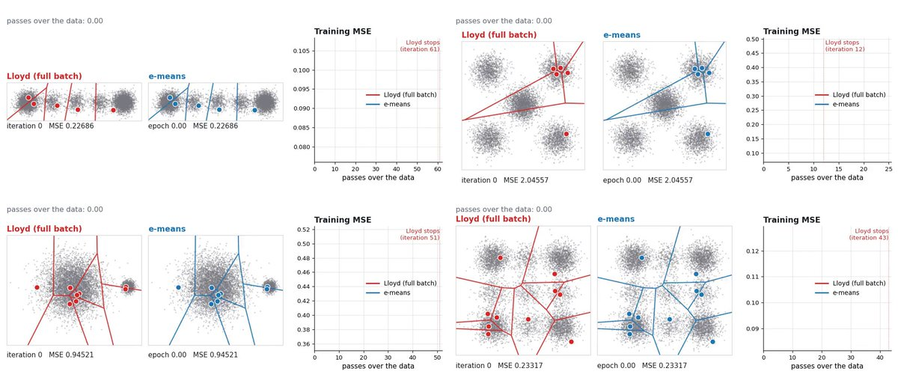
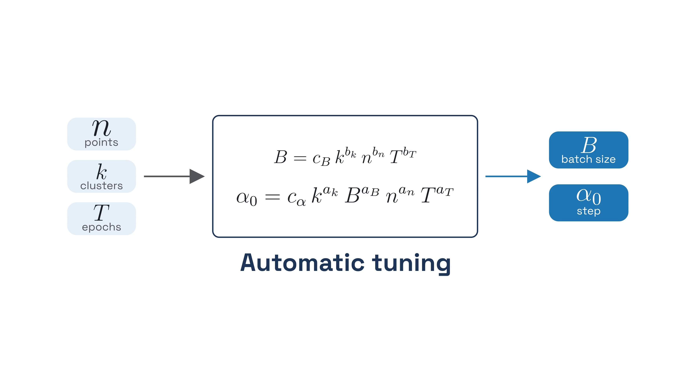
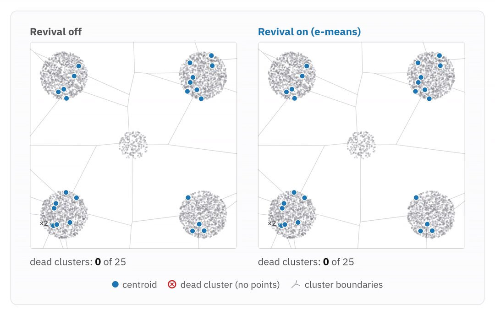
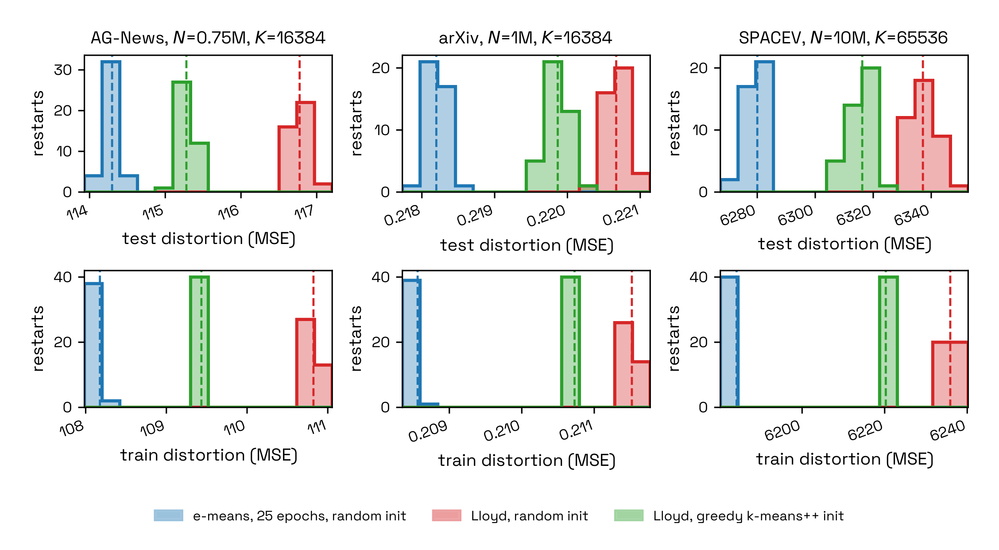
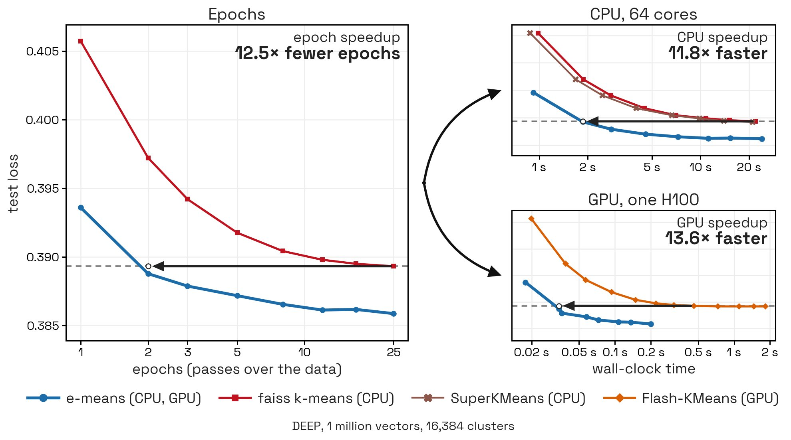
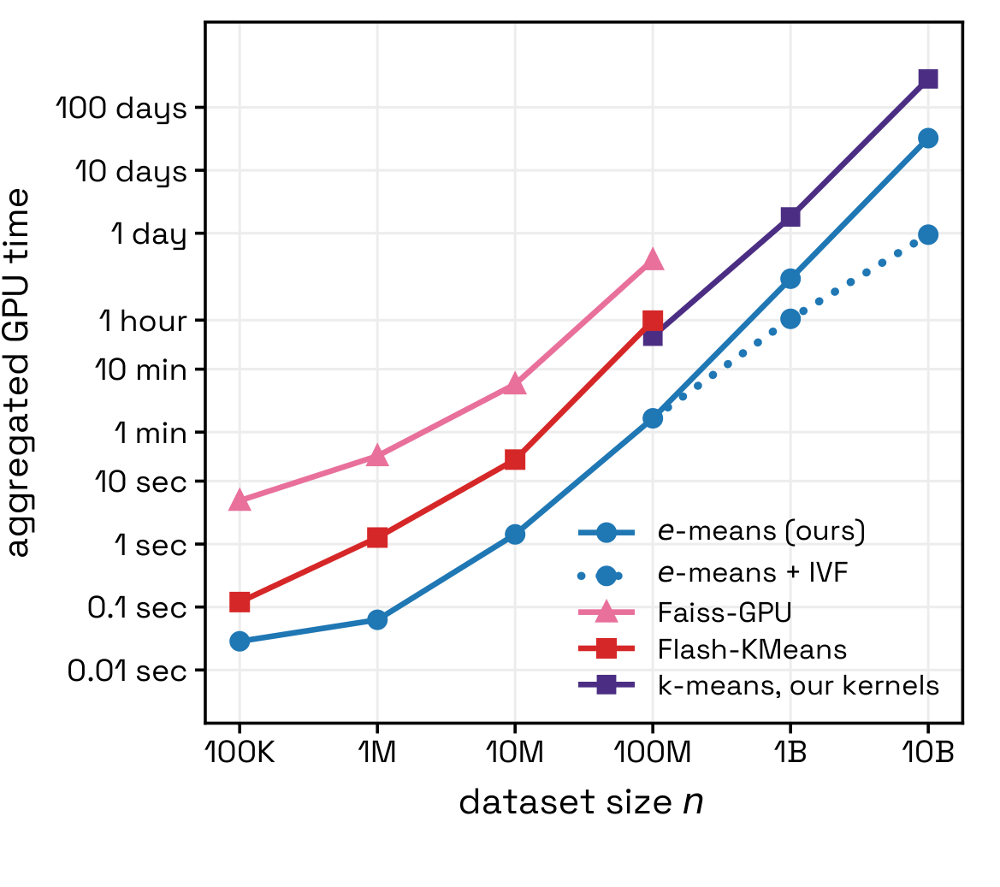

::: {.callout-warning}
# New (Nov 2026)
The paper is fresh and not yet peer reviewed; speedups are as reported by the authors.
:::

# Classic k-means, in brief

`k-means` groups unlabelled points into $k$ clusters. Lloyd's algorithm places $k$ centres, assigns each point to the nearest one, moves each centre to the mean of its points, and repeats. That is the same goal e-means keeps. For the full walk-through — the loop, inertia, k-means++, how to choose $k$, and a scikit-learn lab — see [k-means](algo-k-means.qmd).

e-means keeps the same $k$ centroids and the same MSE, but needs far fewer passes over the data. The rest of this page explains what changes, and what the authors report.

# Overview

<mark>`e-means` is a drop-in replacement for Lloyd's `k-means`. It solves the same clustering problem — minimise the mean squared distance of each point to its nearest centroid — but updates those centroids with mini-batch exponential moving averages, so it usually reaches a lower loss in far fewer passes over the data.</mark>

It was introduced in November 2026 by Swann Bessa and colleagues at FAIR at Meta and École Nationale des Ponts et Chaussées, and shipped in [Faiss 1.16.0](https://github.com/facebookresearch/faiss/tree/main/contrib/e_means){.external target="_blank"}[1][2][3].

::: {.callout-note}
# Same problem, different optimiser
e-means is not a new kind of clustering. The inputs are still the dataset and the number of clusters `k`. The outputs are still $k$ centroids and an assignment. What changes is how the centroids move: mini-batches, an exponential moving average, and scaling laws that set the batch size and step size for you[1][3].
:::

The [announcement thread](https://x.com/swann_bessa/status/2120200714630594911){.external target="_blank"}, the [paper](https://arxiv.org/abs/2611.09501){.external target="_blank"}, and the [project site](https://e-means.github.io/){.external target="_blank"} (with a [browser playground](https://e-means.github.io/playground.html){.external target="_blank"}) are the primary sources for this page.

# What e-means changes

Think of Lloyd as a teacher who only moves the classroom desks after taking attendance of *every* student. One complete roll-call, then one simultaneous move.

e-means walks the room in **small groups**. After each group, every desk slides a little toward the students currently sitting there. The slide is an **exponential moving average (EMA)**: the desk does not jump to the latest group, and it does not forget the groups that came before. It blends the new evidence with what it already knew — like a thermostat that does not slam to the latest reading.

Earlier **mini-batch k-means** methods (MacQueen, Sculley) already update from small batches instead of the full dataset. They can be faster, but when they have been compared with Lloyd they typically finish at a higher error, and the practitioner has to guess a batch size and a step size[1].

{.lightbox width=100% fig-align="center"}

Figure: Swann Bessa et al., via the [X thread](https://x.com/swann_bessa/status/2120201788179808706){.external target="_blank"}. A still from the animation in post 3/10: side-by-side Lloyd and e-means, with training MSE against the number of passes.

The authors specialise the EMA rule for a *fixed* dataset (the usual k-means setting), rather than for a shifting codebook as in VQ-VAEs[1]:

- **Automatic batch size and step size.** Scaling laws, fitted on the DEEP dataset and checked on held-out sets, choose the batch size $B$ and the initial step $\alpha_0$ from $n$, $k$, and the epoch budget $T$. You do not run a hyperparameter sweep[1][2].

{.lightbox width=100% fig-align="center"}

Figure: Swann Bessa et al., via the [X thread](https://x.com/swann_bessa/status/2120202509335793863){.external target="_blank"}. Post 5/10: $n$, $k$ and $T$ go in; batch size $B$ and step $\alpha_0$ come out.

- **A decaying step.** The step $\alpha=1-\gamma$ follows a cosine schedule, from $\alpha_0$ down to $0.1\,\alpha_0$, so the centroids settle as training goes on[1].
- **Dead-cluster revival.** If a cluster stops receiving points, e-means periodically splits a busy "donor" cluster into two, following the same idea Faiss uses for Lloyd. The authors report this as the most important ingredient in their ablation[1][2].

{.lightbox width=100% fig-align="center"}

Figure: Swann Bessa et al., via the [X thread](https://x.com/swann_bessa/status/2120203432275427379){.external target="_blank"}. A still from the bonus animation in post 10/10, comparing dead-cluster revival off and on.

- **A cheap finalisation.** After the last epoch, each centroid is replaced by the exact mean of the points assigned to it in that last pass (the default, which helps training MSE). A slower EMA of the centroids is offered when the goal is out-of-sample (test) MSE[1].

By default e-means starts from a **random sample** of the data, not from k-means++. The paper finds that k-means++ can shave a little more loss, but its cost is high; for a small epoch budget it is usually better to train a bit longer instead[1].

```{mermaid}
flowchart TD
  A[Take a mini-batch] --> B[Assign nearest centre]
  B --> C[EMA-update counts and sums]
  C --> D[Revive dead clusters]
  D --> A
  C --> E[Last epoch: exact mean]
```

# Results, as reported by the authors

These figures come from the paper and the announcement thread. They are the authors' own measurements, mostly on embedding datasets, against strong library baselines — not a re-run on this wiki[1][2].

| Claim | What the authors report | Source |
| --- | --- | --- |
| Epochs to beat Lloyd at 25 iterations | On a wide array of embedding datasets, e-means reaches a test loss below Lloyd at 25 epochs in **1.4 to 2.6 epochs** | Paper abstract[1] |
| GPU wall-clock | That epoch advantage is reported as **10–45×** in the abstract, and as **9.5× to 45.5×** versus Flash-KMeans in Table 4 (medians over seeds, up to 1 billion points) | Abstract and Table 4[1] |
| Quality at a short budget | Three epochs of e-means from random initialisation beat Flash-KMeans at 25 iterations on all eight main setups in Table 5; after five epochs it also stays ahead of Flash-KMeans with greedy k-means++ initialisation | Table 5[1] |
| Very large scale | On **DINO10B** (10 billion DINO embeddings), e-means partitions the data into **16 million** clusters in **2.5 epochs**, with a loss below Lloyd at 25 epochs | Abstract[1] |
| Coverage | The thread describes evaluation on **26 datasets**, from 100k to 10 billion points, with a [results map](https://e-means.github.io/results-map.html){.external target="_blank"} | Thread, post 6/10[2] |

The 10× headline is a comparison with **state-of-the-art implementations** (Faiss on CPU, Flash-KMeans on GPU), not with a naïve Python loop. Swann Bessa made that distinction in the thread[2].

{.lightbox width=100% fig-align="center"}

Figure: Swann Bessa et al., via the [X thread](https://x.com/swann_bessa/status/2120202084112896470){.external target="_blank"}. Post 4/10: on these embedding datasets, e-means from a random initialisation (blue) often finishes at a lower loss than Lloyd, including Lloyd with greedy k-means++ (green).

{.lightbox width=100% fig-align="center"}

Figure: Swann Bessa et al., via the [X thread](https://x.com/swann_bessa/status/2120202706077761660){.external target="_blank"}. Post 7/10, on DEEP with 1 million vectors and 16,384 clusters. The annotated speedups (12.5× fewer epochs, 11.8× CPU, 13.6× GPU) are the authors' labels on this figure.

{.lightbox width=100% fig-align="center"}

Figure: Swann Bessa et al., via the [X thread](https://x.com/swann_bessa/status/2120202825649082652){.external target="_blank"}. Post 8/10: at billion scale the authors pair e-means with an IVF index for a further wall-clock cut.

::: {.callout-caution}
# A limitation, also from the paper
The scaling laws were tuned for relatively high-dimensional embedding data. The authors say they are **not optimal on very low-dimensional and tiny datasets**[1]. In Faiss, the defaults already change in that regime: for $d \le 16$ the "quality" (smaller) batch law is used, and for $d \le 2$ dead-cluster revival is turned off[3].
:::

# How to try it in Faiss

e-means ships in **Faiss 1.16.0** as `faiss.contrib.e_means`. On CPU, `faiss-cpu` is enough. On GPU, training runs through PyTorch (with optional Triton or CuTe kernels); the data must already be on the GPU[2][3].

The snippet below follows the official Faiss user guide. Default `nepochs` is 5, which the authors describe as typically enough to beat Lloyd's loss at convergence[3].

```python
import numpy as np
from faiss.contrib.e_means import NumpyEmeans

x = np.random.rand(200_000, 64).astype("float32")

em = NumpyEmeans(64, 500)          # d=64, k=500; 5 epochs by default
centroids, labels = em.train(x)    # centroids: (500, 64)

x_new = np.random.rand(100_000, 64).astype("float32")
distances, new_labels = em.assign(x_new)
```

On a GPU, import `Emeans` and pass a tensor that is already on the device:

```python
import torch
from faiss.contrib.e_means import Emeans

xg = torch.from_numpy(x).cuda().to(torch.bfloat16)
em = Emeans(64, 1024)
centroids, labels = em.train(xg)
```

`labels` from `train` are the assignments from the **last training epoch**. Because the centroids still moved during that epoch, they are not always each vector's nearest *final* centroid. For exact nearest-centroid labels, call `assign` on the training set as well[3].

# When to use it

**A good default** when you already cluster with Faiss or another high-performance k-means, especially on large embedding sets, IVF codebook training, or any job where 25 Lloyd iterations are the bottleneck[1][2].

**Stay with ordinary k-means** for tiny or very low-dimensional problems (the laws are not tuned for them), or when you only have scikit-learn and a small dataset where Lloyd is already cheap. e-means is in Faiss, not in scikit-learn. See the [k-means](algo-k-means.qmd) lab for that path.

e-means speeds up **training** of an IVF index. It is not a claim about later search latency once that index is built; the paper discusses the effect on recall in Appendix L[1][2].

# Summary

| | Lloyd k-means | e-means |
| --- | --- | --- |
| Objective | Minimise MSE to $k$ centroids | The same |
| Update | Full-dataset mean, each epoch | Mini-batch EMA, then a last-epoch mean |
| Extra knobs beyond $k$ and epochs | None in the usual Faiss call | None required: batch size and step come from scaling laws |
| Typical budget in the paper | 25 epochs as the Faiss-style reference | 1.4–2.6 epochs to pass that reference loss, 5 by default in Faiss |
| Initialisation in the main experiments | Often k-means++ | Random sample of the data |
| Where it lives | Faiss `Kmeans`, scikit-learn, and many other libraries | Faiss 1.16.0, `faiss.contrib.e_means` |

# FAQ

**Is the "e" a new distance or a new cluster shape?**
No. The "e" is for the **exponential moving average** used to update the centroids[1][3].

**Do I still choose $k$?**
Yes. $k$ is still the main modelling choice. The batch size and step size are the parts e-means can set for you[1][3].

**Why is it faster if each epoch still assigns points to centroids?**
The assignment work per epoch is comparable to Lloyd. The speed-up comes from needing **many fewer epochs** (and from specialised kernels that turn that into wall-clock savings)[1].

**Can I set the batch size myself?**
Yes. In Faiss you can pass `batch_size` or `batch_law="quality"` / `"throughput"`. If you set only the batch size, $\alpha_0$ is still taken from the step-size law[3].

**Are the last-epoch labels exact?**
Not necessarily. Use `assign` when you need each point's nearest final centroid[3].

# References

- [1] Swann Bessa, Pierre-Emmanuel Mazaré, Gergely Szilvasy, Hugo Touvron, David Picard, Matthijs Douze, and Hervé Jégou, *e-means: outperforming k-means (in one-tenth the epochs)*, arXiv:2611.09501, 10 November 2026. [https://arxiv.org/abs/2611.09501](https://arxiv.org/abs/2611.09501){.external target="_blank"}
- [2] Swann Bessa, announcement thread, 10 November 2026, 18:03 Europe/Madrid. [https://x.com/swann_bessa/status/2120200714630594911](https://x.com/swann_bessa/status/2120200714630594911){.external target="_blank"}
- [3] Faiss user guide, `contrib/e_means`, in the 1.16.0 release. [https://github.com/facebookresearch/faiss/tree/main/contrib/e_means](https://github.com/facebookresearch/faiss/tree/main/contrib/e_means){.external target="_blank"}
- [4] Project site, browser demo, and results map: [https://e-means.github.io/](https://e-means.github.io/){.external target="_blank"}, [playground](https://e-means.github.io/playground.html){.external target="_blank"}, [results map](https://e-means.github.io/results-map.html){.external target="_blank"}
- Reproduction scripts for the paper figures: [https://github.com/facebookresearch/faiss/tree/main/benchs/e_means](https://github.com/facebookresearch/faiss/tree/main/benchs/e_means){.external target="_blank"}
