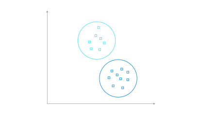

# Overview

`K-Means` algorithms classify data into clusters—where K equals the number of clusters. The data points inside of each cluster are homogeneous, and they’re heterogeneous to data points in other clusters.

::: {.column-margin}
{.lightbox width=100% fig-align="center"}
:::

`Clustering` is the job of grouping similar points together when nobody has given you the labels in advance.

Think of a market and a mixed pile of fruit. You want $k$ stalls. You place the stalls, each fruit goes to the **nearest** stall, then you slide each stall to the **middle** of its fruit, and you repeat until the stalls barely move. Apples end up with apples and oranges with oranges — even though you never wrote "apple" on a sign.

That procedure is **Lloyd's algorithm**, the classic solver for `k-means`[1].

# Lloyd's loop

1. **Choose $k$** — how many groups you want. The algorithm does not pick this for you.
2. **Initialise the centres** — pick $k$ starting points in the data. A common choice is `k-means++`, which spreads the first centres out instead of dropping them all in one corner[2].
3. **Assign** — send every point to its nearest centre.
4. **Update** — move each centre to the **mean** (the average position) of the points assigned to it.
5. **Repeat** until the assignment stops changing, or you hit a maximum number of passes.

```{mermaid}
flowchart TD
  A[Choose k] --> B[Place centres]
  B --> C[Assign nearest centre]
  C --> D[Move to the mean]
  D --> E{Still moving?}
  E -->|yes| C
  E -->|no| F[Done]
```

# The objective: inertia, or WCSS

k-means looks for $k$ centroids that make the clusters as tight as possible. The usual score is the **within-cluster sum of squares** (WCSS), also called **inertia**: the sum of the squared distances from each point to its nearest centre[3]:

$$
J = \sum_{i=1}^{n} \|x_i - c_{a(i)}\|^2,
\quad a(i)=\arg\min_j\|x_i-c_j\|^2.
$$

The **mean squared error (MSE)** is the same quantity divided by $n$. scikit-learn stores inertia as `inertia_` after `fit`. Lower is tighter, but $J$ always falls as $k$ grows, so a smaller inertia alone does not mean a better $k$.

# k-means++ initialisation

A bad starting set of centres can trap Lloyd in a weak **local minimum**. `k-means++` (Arthur and Vassilvitskii, 2007) spreads the first centres out: the first centre is chosen at random, and each next one is sampled with probability proportional to its squared distance to the nearest centre already chosen[2].

It does not remove local minima, and the seeding itself can be slow on very large data, but it is the usual default in scikit-learn and a clear improvement on a purely random start.

# Choosing $k$

You still have to choose $k$. Two simple checks:

- **Elbow.** Plot inertia against $k$. The curve falls quickly at first, then flattens. The "elbow" is a pragmatic guess for $k$, not a proof.
- **Silhouette.** For each point, compare how close it is to its own cluster versus the next-nearest cluster. The score sits between $-1$ and $1$; values near $1$ mean tight, well-separated groups. Compute the mean silhouette for several $k$ and prefer a peak.

Neither method is automatic magic. Use them together with what you know about the data.

# Limits you should know

- You must **choose $k$**.
- Results are **sensitive to initialisation** and can stop in a **local minimum**.
- k-means favours **compact, roughly spherical** clusters of similar size, because each centre is a mean and the distance is Euclidean. Elongated, nested, or very uneven groups can be split badly.
- **Scale the features.** A variable with a huge range will dominate the distances.
- **Outliers** pull the mean, and therefore the centre.
- **Many iterations** may be needed, and each one rereads the whole dataset. One pass compares each of the $n$ points to all $k$ centres in $d$ dimensions, so the work per pass grows with $n \times k \times d$. Libraries usually cap the number of passes.

# Variants

- **Mini-batch k-means** updates the centres from small batches instead of the full dataset. It can be faster on large data, but you have to choose a batch size, and the final error is often a little higher than full-batch Lloyd.
- **k-medoids** uses an actual data point (a *medoid*) as the centre of each cluster, rather than the mean. That is often more robust to outliers, and it can use other distances than Euclidean.
- **e-means** (2026) keeps the same MSE objective as k-means, but updates centres with mini-batch exponential moving averages and scaling laws that set the batch size and step for you. See [e-means](algo-e-means.qmd).

# Python lab

A short scikit-learn walk-through: make a blob dataset, fit k-means, plot the groups, then draw an elbow curve[3].

```python
import matplotlib.pyplot as plt
from sklearn.datasets import make_blobs
from sklearn.cluster import KMeans

X, y_true = make_blobs(
    n_samples=500, centers=4, cluster_std=0.70, random_state=42
)

model = KMeans(n_clusters=4, init="k-means++", n_init=10, random_state=42)
labels = model.fit_predict(X)

plt.scatter(X[:, 0], X[:, 1], c=labels, s=20)
plt.scatter(
    model.cluster_centers_[:, 0],
    model.cluster_centers_[:, 1],
    c="black",
    s=80,
    marker="x",
)
plt.title("k-means on four blobs")
plt.show()

# Elbow: inertia versus k
ks = range(1, 9)
inertias = []
for k in ks:
    km = KMeans(n_clusters=k, init="k-means++", n_init=10, random_state=42)
    km.fit(X)
    inertias.append(km.inertia_)

plt.plot(ks, inertias, marker="o")
plt.xlabel("k")
plt.ylabel("inertia (WCSS)")
plt.title("Elbow plot")
plt.show()
```

# Summary

| Topic | In brief |
| --- | --- |
| Goal | Split unlabelled points into $k$ tight groups |
| Loop | Place centres, assign, move each centre to the mean, repeat |
| Score | Inertia / WCSS (sum of squared distances); MSE is the same quantity divided by $n$ |
| Initialisation | `k-means++` is the usual default; still a local-minimum method |
| Choosing $k$ | Elbow plot of inertia, plus silhouette, plus domain knowledge |
| Watch out | Scaling, outliers, non-spherical clusters, many full-dataset passes |
| A faster variant | [e-means](algo-e-means.qmd), when you already use a high-performance k-means |

# FAQ

**Is $k$ learned from the data?**
No. You choose $k$, then the algorithm places the centres.

**Does k-means++ always find the global best clustering?**
No. It is a better start, not a guarantee. Several restarts (`n_init` in scikit-learn) are still useful.

**Why did my features need scaling?**
Distances are Euclidean. A feature measured in thousands will drown one measured in units, unless you scale them.

**When should I try e-means instead?**
When the dataset is large and many Lloyd passes are the bottleneck. For a small scikit-learn problem, classic k-means is usually enough. See [e-means](algo-e-means.qmd).

# See also

For a faster drop-in replacement of Lloyd's k-means, with mini-batch exponential moving averages and no extra hyperparameter sweep, see [e-means](algo-e-means.qmd).

# References

- [1] Stuart P. Lloyd, *Least squares quantization in PCM*, IEEE Transactions on Information Theory, 28(2):129–137, 1982. [https://doi.org/10.1109/TIT.1982.1056489](https://doi.org/10.1109/TIT.1982.1056489){.external target="_blank"}
- [2] David Arthur and Sergei Vassilvitskii, *k-means++: The advantages of careful seeding*, Proceedings of SODA, 2007, pp. 1027–1035. [ACM DL](https://dl.acm.org/doi/10.5555/1283383.1283494){.external target="_blank"}, [author PDF](https://theory.stanford.edu/~sergei/papers/kMeansPP-soda.pdf){.external target="_blank"}
- [3] scikit-learn documentation, *Clustering: K-means*. [https://scikit-learn.org/stable/modules/clustering.html#k-means](https://scikit-learn.org/stable/modules/clustering.html#k-means){.external target="_blank"}, and [`sklearn.cluster.KMeans`](https://scikit-learn.org/stable/modules/generated/sklearn.cluster.KMeans.html){.external target="_blank"}
