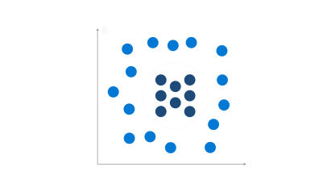

# Overview

`Naïve Bayes` algorithms calculate the probability that an event will occur, based on the occurrence of a related event.

::: {.column-margin}
{.lightbox width=100% fig-align="center"}
:::