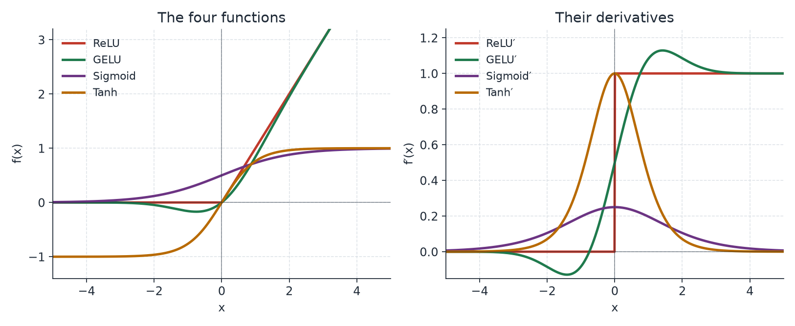
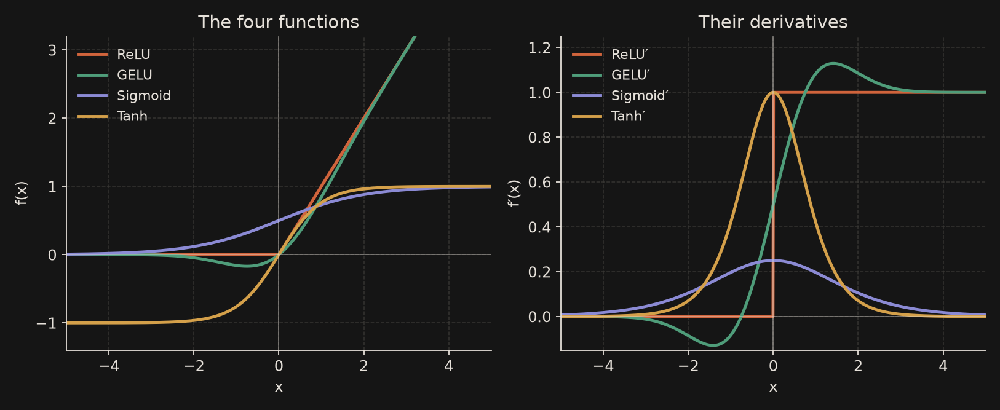
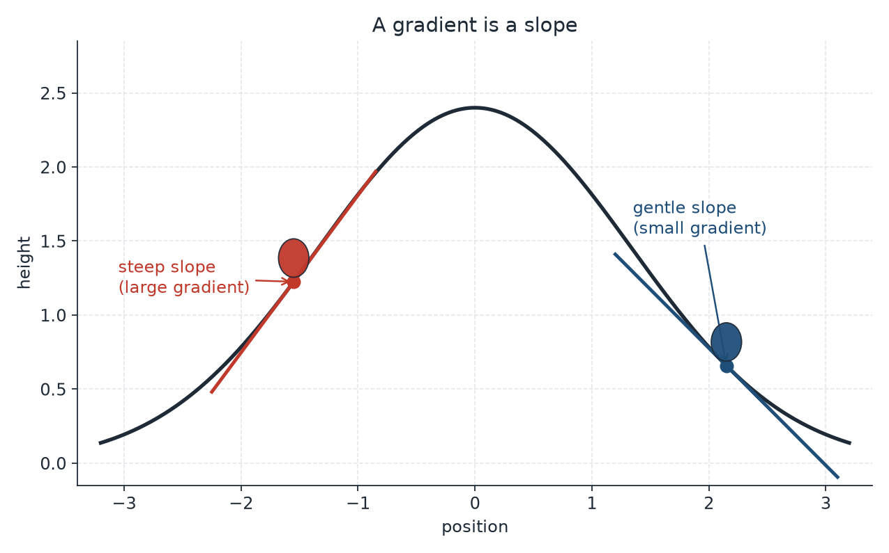
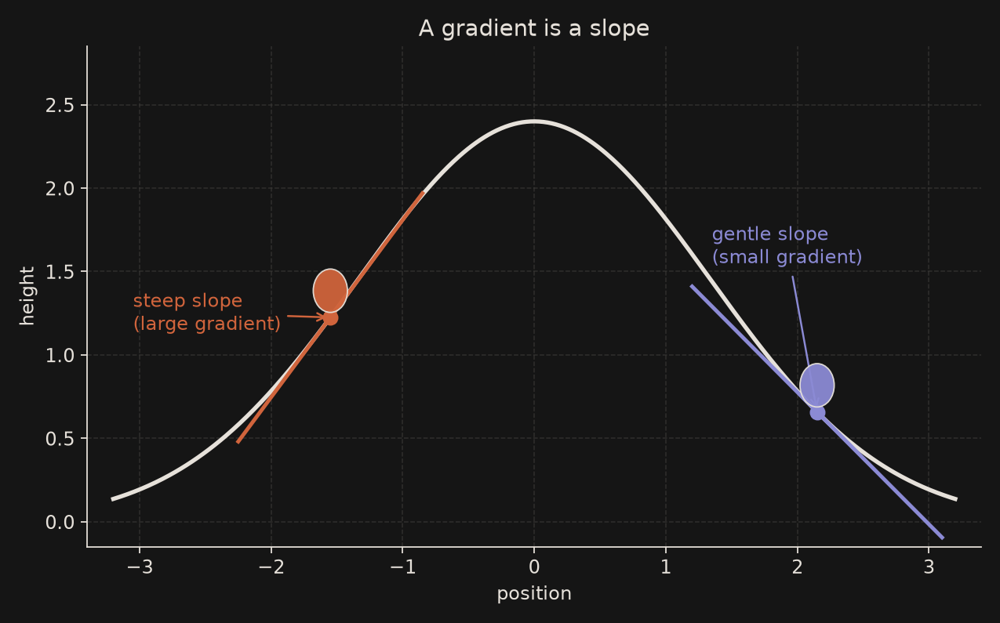
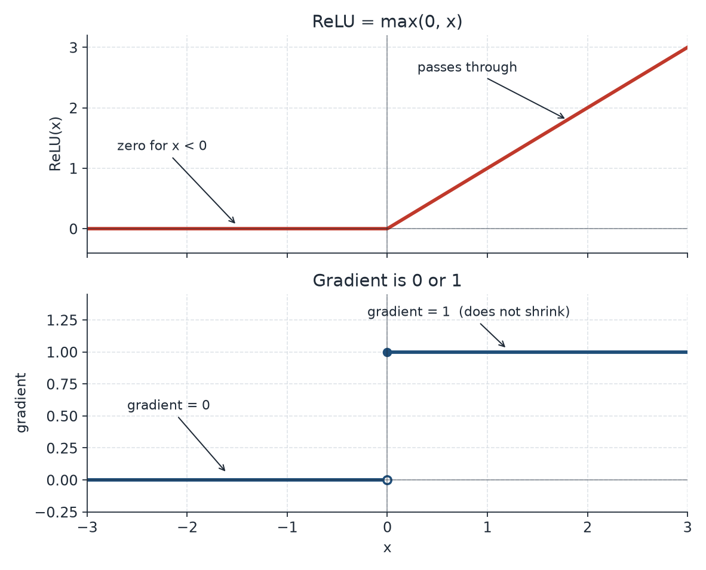
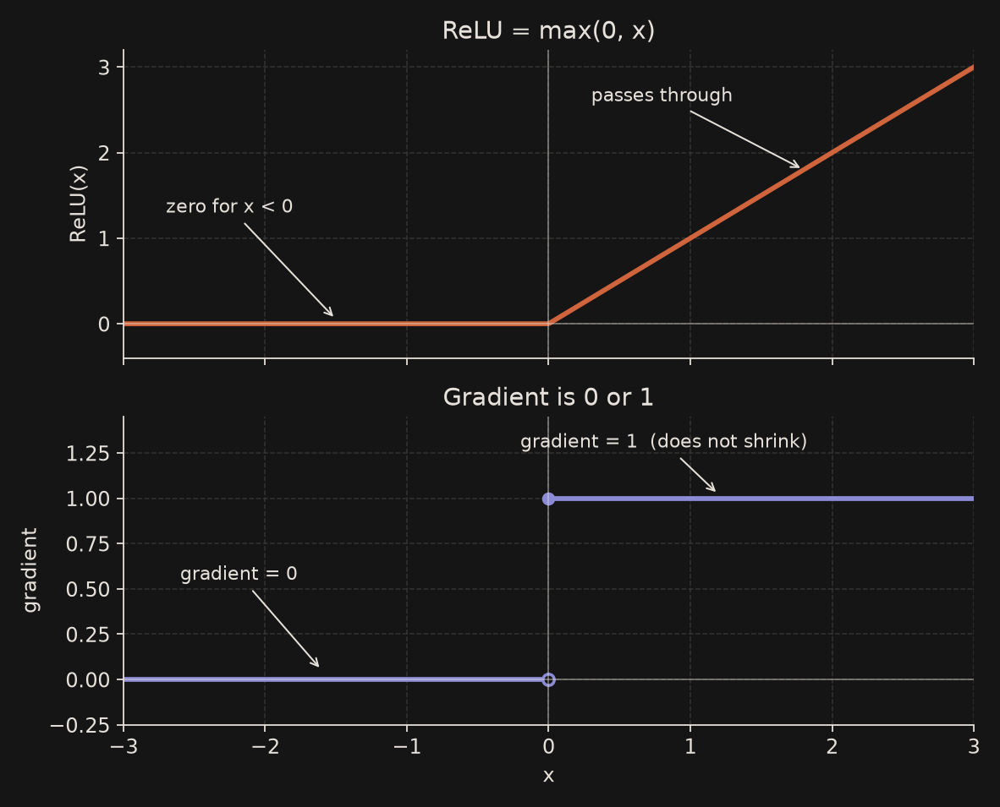
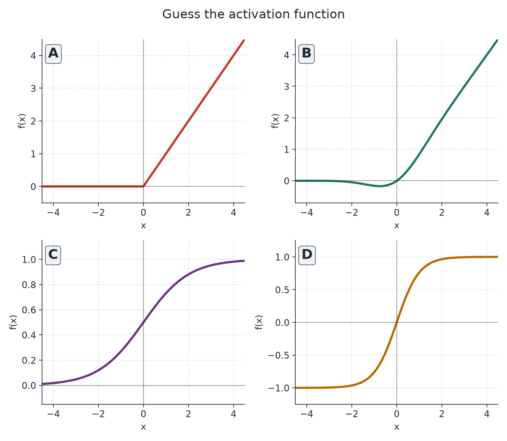
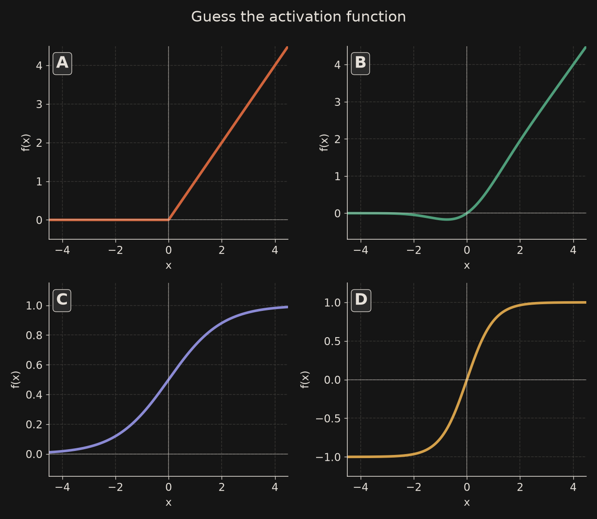

# What an activation function is

<mark>An **activation function** is a simple rule that sits at the end of a neuron: after the neuron has formed a weighted sum of its inputs plus a bias, the activation decides what number is sent on to the next layer.</mark>

Without it, a neuron would only ever pass along a straight-line combination of its inputs. With it, the neuron can turn off, saturate, or bend — and that is what lets a network learn curves, not just lines.

```{mermaid}
flowchart TD
  A[Inputs] --> B[Weighted sum plus bias]
  B --> C[Activation]
  C --> D[Next layer]
```

# Why the network needs non-linearity

If every layer used only a linear map, stacking ten layers would still be *one* linear map. A composition of straight lines is another straight line, so the whole network could be replaced by a single layer.

A **non-linear** activation breaks that collapse. Each layer can now fold the space a little, and depth starts to matter. That is why ReLU, sigmoid, tanh and GELU are not decorations: they are what make a deep network actually deep.

# The four, in brief

Four functions cover most of what you will meet in class and in modern models. A one-line formula and a one-line intuition for each; the details come after a short word on gradients.

| Function | Formula | Intuition |
| --- | --- | --- |
| **ReLU** | $\max(0,x)$ | Keep the positive part; silence the rest. |
| **Sigmoid** | $1/(1+e^{-x})$ | Squash every input into $(0,1)$. |
| **Tanh** | $\tanh(x)$ | Squash into $(-1,1)$, centred on zero. |
| **GELU** | $x\cdot\Phi(x)$ | A smooth ReLU that lets a little of the negative side through. |

{.light-only .lightbox width=100% fig-align="center"}

{.dark-only .lightbox width=100% fig-align="center"}

# A gradient primer

Training moves the weights by following a **gradient**: the slope of the loss with respect to each weight. A handy picture is a ball on a hill. Where the hillside is steep, the slope is large and the ball rolls fast. Where the hillside is almost flat, the slope is small and the ball barely moves. For the symbol $\nabla$ itself, and a one-step numeric descent, see [ML math symbols](/foundations/maths/maths-symbols.qmd) and [Calculus essentials](/foundations/maths/maths-calculus.qmd).

{.light-only .lightbox width=80% fig-align="center"}

{.dark-only .lightbox width=80% fig-align="center"}

Two practical words will keep coming back:

- **Cheap.** Some activations are a comparison and a `max` (ReLU). Others need an exponential or a Gaussian CDF (sigmoid, tanh, GELU). In a big network that function is called billions of times, so a cheap slope matters.
- **Does not shrink.** During backpropagation the incoming gradient is multiplied by the slope of the activation. If that slope is $1$, the signal keeps its size. If the slope is $0.2$ or $0.01$, the signal shrinks at every layer and can **vanish**. If the slope is $0$, that neuron contributes nothing to the update.

# A. ReLU

$$
\operatorname{ReLU}(x)=\max(0,x).
$$

A negative input becomes $0$. A positive input passes through unchanged. The gradient is $0$ for $x<0$ and $1$ for $x>0$ (the kink at $0$ is usually given gradient $0$).

That is why ReLU is **cheap** and, for positive inputs, **does not shrink** the gradient. It is the default hidden activation in convolutional networks and ordinary MLPs, and a solid first choice for an MNIST classifier.

The weakness is **dead neurons**. If a unit is pushed into the negative side and stays there, it outputs $0$ and its gradient is $0$, so the weights that feed it stop receiving updates. A high learning rate, or a bad initialisation, can kill many units this way.

{.light-only .lightbox width=80% fig-align="center"}

{.dark-only .lightbox width=80% fig-align="center"}

# B. GELU

$$
\operatorname{GELU}(x)=x\cdot\Phi(x),
$$

where $\Phi$ is the cumulative distribution function of the standard normal. A widely used approximation is[1]

$$
\operatorname{GELU}(x)\;\approx\;x\cdot\sigma(1.702\,x),
$$

with $\sigma$ the sigmoid.

GELU is a **smooth ReLU**. Around zero it has a small negative dip (the minimum is about $-0.17$), then it rises almost like a straight line. The gradient is smooth, and neurons rarely die, because a slightly negative input is not hard-zeroed.

It is the standard hidden activation in Transformers such as BERT and GPT[1][3].

**SiLU / Swish**, $x\cdot\sigma(x)$, looks almost identical, but its negative dip is deeper: $\operatorname{SiLU}(-1)\approx-0.269$, against $\operatorname{GELU}(-1)\approx-0.159$.

# C. Sigmoid

$$
\sigma(x)=\frac{1}{1+e^{-x}}.
$$

The range is $(0,1)$, and $\sigma(0)=0.5$. The derivative is $\sigma(x)\bigl(1-\sigma(x)\bigr)$, whose maximum is $0.25$ at $x=0$. Away from zero the curve flattens, the slope goes toward $0$, and **gradients vanish**.

That is why sigmoid is a poor default in hidden layers of a deep net, but it is still the right tool when you need a number in $(0,1)$: a **binary output**, or a **gate** in an LSTM.

# D. Tanh

$$
\tanh(x)=\frac{e^{x}-e^{-x}}{e^{x}+e^{-x}}.
$$

The range is $(-1,1)$, and the output is **zero-centred**, which is often a kinder hidden representation than a sigmoid that only sits in $(0,1)$. The derivative is $1-\tanh^{2}(x)$, whose maximum is $1$ at the origin — four times the peak sigmoid slope — but tanh still **saturates** in the tails, so gradients can vanish there too.

It is a classic choice in RNNs and LSTMs, and whenever you want a bounded, signed output. It is not a new shape: it is a rescaled sigmoid,

$$
\tanh(x)=2\sigma(2x)-1.
$$

# Why language models moved from ReLU to GELU

Compare a single negative input:

$$
\operatorname{ReLU}(-1)=0,\qquad\operatorname{GELU}(-1)\approx-0.159.
$$

ReLU applies a hard cutoff. GELU lets a little of that negative signal through, and the transition is smooth, so the gradient does not jump from $1$ to $0$.

GELU was introduced by Hendrycks and Gimpel in 2016[1] and then adopted in BERT and in the GPT family[3]. The catch is important: GELU is **not universally better**. Its popularity comes from **empirical results**, not from a theorem that it must win on every task. On a small CNN, ReLU is still often the simpler and faster default.

Later work went a step further. Shazeer (2020) showed that **gated linear units**, including **SwiGLU** (a gated SiLU), can improve Transformers[2]. Many later language models use that gated family rather than a plain GELU.

# Quiz: Guess the activation function

Four unlabelled curves. Name each one before you open the answers.

{.light-only .lightbox width=100% fig-align="center"}

{.dark-only .lightbox width=100% fig-align="center"}

::: {.callout-tip collapse="true"}
# Answers

- **A** — ReLU. A hard corner at zero, then a straight line for $x>0$.
- **B** — GELU. Smooth, almost like ReLU, with a small negative dip.
- **C** — Sigmoid. An S-curve in $(0,1)$, with $\sigma(0)=0.5$.
- **D** — Tanh. An S-curve in $(-1,1)$, zero-centred.
:::

# Python lab

A short numpy and matplotlib walk-through: plot the four functions and their derivatives. Run the cell in a notebook; this page does not execute it at build time.

```python
import numpy as np
import matplotlib.pyplot as plt
from math import erf, exp, sqrt, pi

x = np.linspace(-5, 5, 800)

def relu(x):
    return np.maximum(0, x)

def sigmoid(x):
    return 1 / (1 + np.exp(-x))

def tanh(x):
    return np.tanh(x)

def gelu(x):
    # exact GELU: x * Phi(x), with Phi the standard normal CDF
    Phi = np.vectorize(lambda z: 0.5 * (1 + erf(z / sqrt(2))))
    return x * Phi(x)

def relu_grad(x):
    return (x > 0).astype(float)

def sigmoid_grad(x):
    s = sigmoid(x)
    return s * (1 - s)

def tanh_grad(x):
    t = np.tanh(x)
    return 1 - t**2

def gelu_grad(x):
    Phi = np.vectorize(lambda z: 0.5 * (1 + erf(z / sqrt(2))))
    phi = np.exp(-0.5 * x**2) / sqrt(2 * pi)
    return Phi(x) + x * phi

fig, axes = plt.subplots(1, 2, figsize=(10, 4))

axes[0].plot(x, relu(x), label="ReLU")
axes[0].plot(x, gelu(x), label="GELU")
axes[0].plot(x, sigmoid(x), label="Sigmoid")
axes[0].plot(x, tanh(x), label="Tanh")
axes[0].set_title("The four functions")
axes[0].legend()
axes[0].grid(True, linestyle="--", alpha=0.6)

axes[1].plot(x, relu_grad(x), label="ReLU'")
axes[1].plot(x, gelu_grad(x), label="GELU'")
axes[1].plot(x, sigmoid_grad(x), label="Sigmoid'")
axes[1].plot(x, tanh_grad(x), label="Tanh'")
axes[1].set_title("Their derivatives")
axes[1].legend()
axes[1].grid(True, linestyle="--", alpha=0.6)

plt.tight_layout()
plt.show()
```

# Rule of thumb

- **Hidden layers in a CNN or MLP** (for example an MNIST classifier): start with **ReLU**.
- **Transformers** (BERT, GPT and their relatives): **GELU**, or a later gated variant such as SwiGLU.
- **Binary outputs** and **LSTM gates**: **sigmoid**.
- **Zero-centred, bounded hidden states** (classic RNNs): **tanh**.

If many ReLU units die, lower the learning rate, or try a smooth alternative such as GELU.

# Summary

| Function | Range | Gradient max | Cost | Where it is used |
| --- | --- | --- | --- | --- |
| ReLU | $[0,\infty)$ | $1$ | Cheap (`max`) | Default in CNNs and MLPs |
| GELU | about $[-0.17,\infty)$ | about $1.13$ | Dearer (CDF or a sigmoid approximation) | Transformers (BERT, GPT) |
| Sigmoid | $(0,1)$ | $0.25$ | Exponential | Binary outputs, LSTM gates |
| Tanh | $(-1,1)$ | $1$ | Exponential | RNNs, LSTMs, bounded outputs |

# FAQ

**Why not use a linear activation in every layer?**
A stack of linear layers is still one linear layer. You need a non-linearity so that depth can learn curved decision surfaces.

**What is a dead ReLU?**
A neuron that always outputs $0$. Its gradient is $0$, so the usual update cannot revive it.

**Is GELU always better than ReLU?**
No. GELU won a lot of language-model bake-offs, but that is an empirical pattern, not a proof. On a small vision model, ReLU is still a good default.

**If sigmoid shrinks gradients, why is it still taught?**
Because it is the natural map into $(0,1)$. Use it at an output, or as a gate, not as the hidden activation of a deep stack.

**Is softmax an activation of the same kind?**
Softmax is a *vector* normalisation used on a multi-class output. It is not a drop-in hidden activation like the four on this page.

**Where does the $1.702$ in the GELU approximation come from?**
It is the constant Hendrycks and Gimpel fitted so that $x\cdot\sigma(1.702x)$ tracks $x\cdot\Phi(x)$ closely[1].

# See also

- [ANN: Introduction](ann-introduction.qmd)
- [ANN: Mathematical model](ann-mathematical.qmd)
- [ANN: model and demos](ann-model-and-demos.qmd)
- [ML math symbols, explained easy](/foundations/maths/maths-symbols.qmd) — $\nabla$, $\sigma$, and a short gradient card
- [Calculus essentials](/foundations/maths/maths-calculus.qmd) — the chain rule and one step of gradient descent

# References

- [1] Dan Hendrycks and Kevin Gimpel, *Gaussian Error Linear Units (GELUs)*, arXiv:1606.08415, 2016. [https://arxiv.org/abs/1606.08415](https://arxiv.org/abs/1606.08415){.external target="_blank"}
- [2] Noam Shazeer, *GLU Variants Improve Transformer*, arXiv:2002.05202, 2020. [https://arxiv.org/abs/2002.05202](https://arxiv.org/abs/2002.05202){.external target="_blank"}
- [3] Jacob Devlin, Ming-Wei Chang, Kenton Lee, and Kristina Toutanova, *BERT: Pre-training of Deep Bidirectional Transformers for Language Understanding*, arXiv:1810.04805, 2018. [https://arxiv.org/abs/1810.04805](https://arxiv.org/abs/1810.04805){.external target="_blank"}
- [4] Vinod Nair and Geoffrey E. Hinton, *Rectified Linear Units Improve Restricted Boltzmann Machines*, Proceedings of ICML, 2010. [PDF](https://icml.cc/Conferences/2010/papers/432.pdf){.external target="_blank"}
