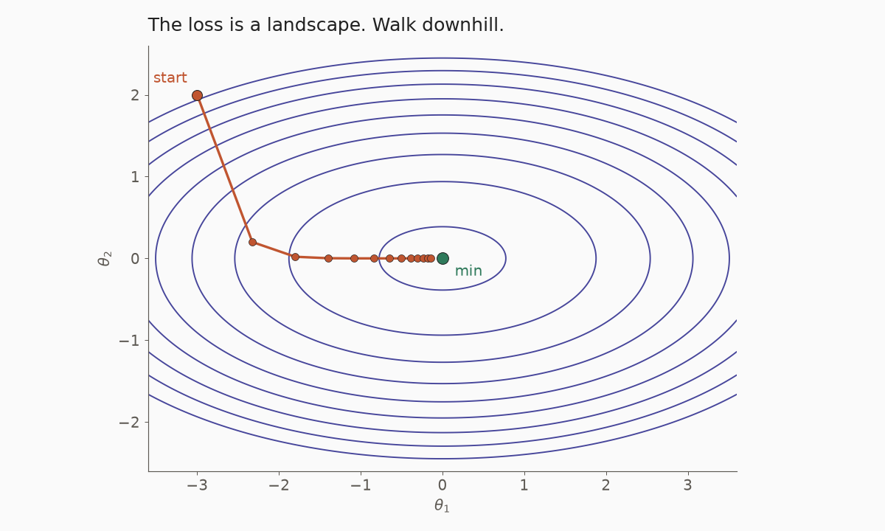
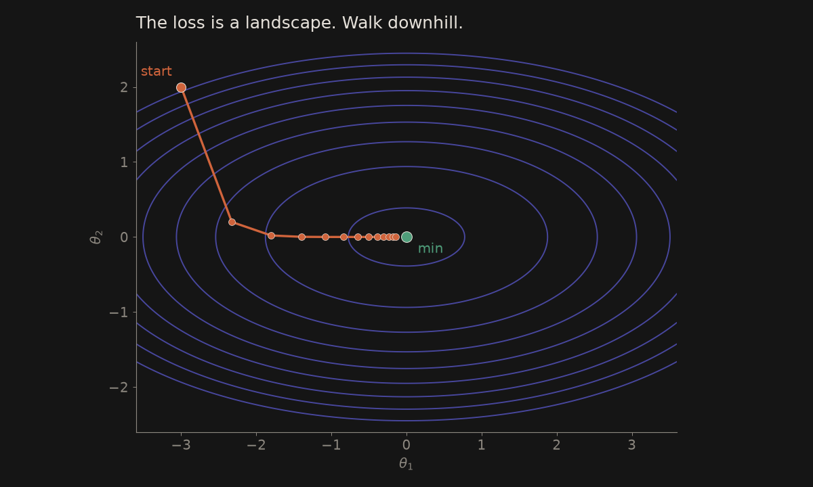
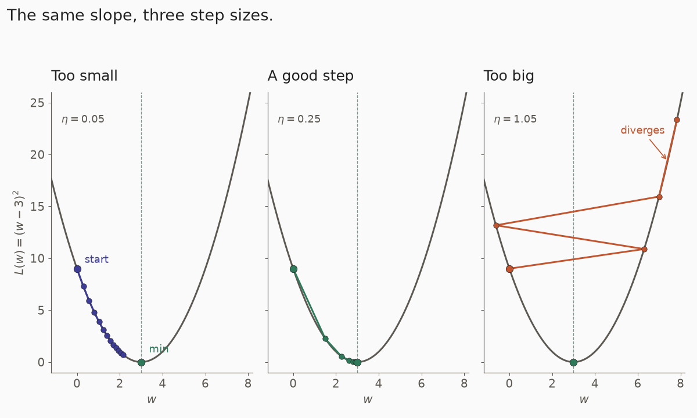
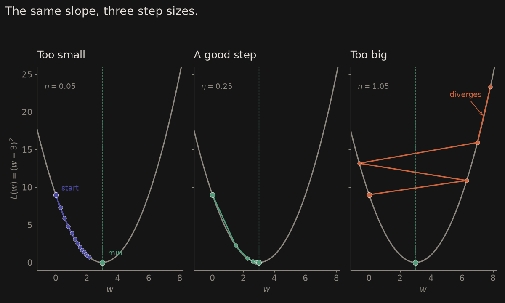
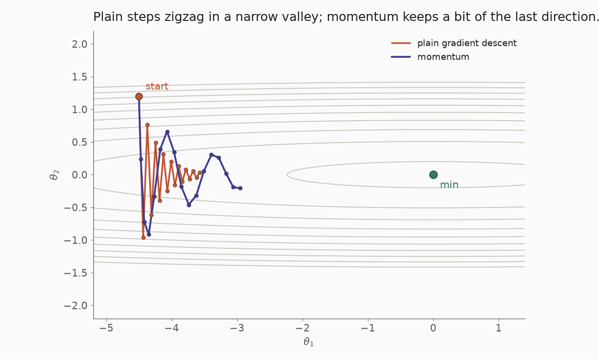
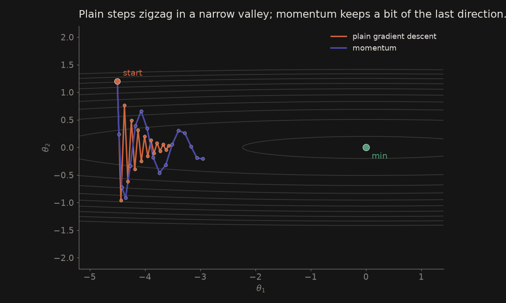

# The loss is a landscape

Training asks: which parameters make the error smaller? Write that error as a **loss** $L(\theta)$. If you imagine $L$ as height, the parameters sit on a landscape. A good model is a low point.

The formal question is $\arg\min_\theta L(\theta)$: which $\theta$ gives the smallest loss? See $\arg\min$ on the [symbols](maths-symbols.qmd#argmin-and-min-the-training-question) page. We rarely solve that in one shot. We walk downhill instead.

::: {.light-only}
{.lightbox width=90% fig-align="center"}
:::

::: {.dark-only}
{.lightbox width=90% fig-align="center"}
:::

# The gradient descent update

The gradient $\nabla L$ (see [calculus](maths-calculus.qmd#partial-derivatives-and-the-gradient-nabla) and the [$\nabla$ card](maths-symbols.qmd#nabla-gradient)) points uphill. A step the other way is

$$
\theta \leftarrow \theta - \eta\,\nabla L(\theta),
$$

where $\eta>0$ is the **learning rate**.

**A tiny numeric example.** Let $L(w)=(w-3)^2$, so $\nabla L=2(w-3)$. Start at $w=5$ with $\eta=0.1$ (the same toy loss as on the [calculus](maths-calculus.qmd#gradient-descent-one-step) page):

$$
w \leftarrow 5 - 0.1\times 4 = 4.6.
$$

The loss falls from $4$ to $2.56$. Repeat, and $w$ drifts toward $3$, where the slope is zero.

# The learning rate: too small or too big

::: {.light-only}
{.lightbox width=100% fig-align="center"}
:::

::: {.dark-only}
{.lightbox width=100% fig-align="center"}
:::

If $\eta$ is too small, each step is a shuffle and training crawls. If $\eta$ is too big, the step overshoots the valley and the loss can bounce or blow up. A good rate is large enough to make progress and small enough to settle.

# Batch, stochastic, and mini-batch

The gradient is an average over examples.

- **Batch** (full-batch) uses every example at once. The path is smooth, but one step can be slow when the dataset is large.
- **Stochastic** gradient descent (SGD) uses *one* example (or one very small draw). The path is noisy, which is cheaper per step and can help the walk leave a shallow dip.
- **Mini-batch** takes a small group, often tens or hundreds of rows. This is the usual compromise: a stabler gradient than one row, still cheap enough to run on a GPU.

# Momentum

Plain steps can zigzag down a long, narrow valley: each step dives toward a wall, then back. **Momentum** keeps a running average of recent gradients and steps in that direction, so the walk builds speed along the valley and damps the zigzag.

::: {.light-only}
{.lightbox width=90% fig-align="center"}
:::

::: {.dark-only}
{.lightbox width=90% fig-align="center"}
:::

# Adam, in one idea

[Adam](https://arxiv.org/abs/1412.6980) (Kingma and Ba, 2014) is a very common default. The name is short for *adaptive moment estimation*. It keeps two running averages: one of the gradient (a momentum term) and one of the *squared* gradient (how large that parameter's slopes have been). Parameters that have been seeing large, noisy slopes get a smaller effective step; quieter ones get a larger one. You still choose a base learning rate, but each parameter then adapts its own pace.

# Local minima and saddle points

A **local minimum** is a dip that is lower than its neighbours, but not necessarily the lowest point on the whole landscape (the **global** minimum). A **saddle point** is a pass: uphill in some directions, downhill in others. In a high-dimensional loss, the walk can slow down near saddles, where the slope is almost flat. Mini-batch noise and methods such as momentum often help the walk keep moving.

# A tiny NumPy walk

```python
import numpy as np

# L(w) = (w - 3)**2, start at 5, learning rate 0.1
w, eta = 5.0, 0.1
for _ in range(5):
    grad = 2 * (w - 3)
    w = w - eta * grad
    print(w, (w - 3)**2)
# 4.6      2.56
# 4.28     1.6384
# 4.024    1.048576
# 3.8192   0.67108864
# 3.65536  0.4294967296
```

The slopes that feed this update come from the chain rule and, in a network, from the [activation functions](/ann/ann-activation-functions.qmd) along the way.

# See also

- [Calculus essentials](maths-calculus.qmd) — the slope, the chain rule, and one step of gradient descent
- [ML math symbols, explained easy](maths-symbols.qmd) — $\nabla$, $\arg\min$
- [ANN: Activation functions](/ann/ann-activation-functions.qmd) — why some slopes vanish
- [Maths for machine learning](maths-index.qmd)

# References

- Diederik P. Kingma and Jimmy Ba, *Adam: A Method for Stochastic Optimization*, arXiv:1412.6980, 2014. [https://arxiv.org/abs/1412.6980](https://arxiv.org/abs/1412.6980){.external target="_blank"}
