# The core symbols

A short deck of the symbols you will keep seeing. Each card has one question, a figure, an everyday example, a tiny numerical example, and a NumPy line.

# $\nabla$ — gradient

**In one line.** Which direction should the parameters move to reduce the loss?

::: {.light-only}
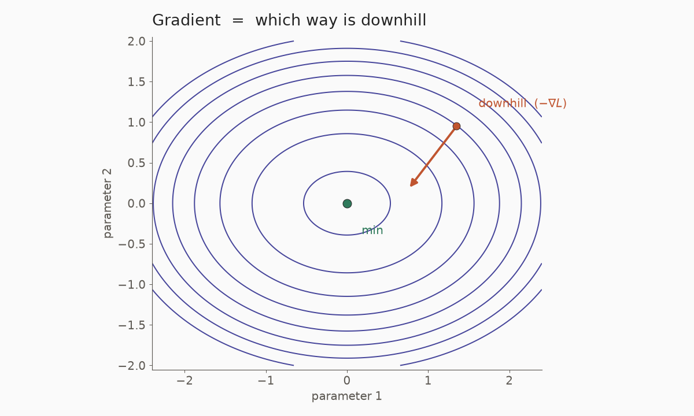{.lightbox width=90% fig-align="center"}
:::

::: {.dark-only}
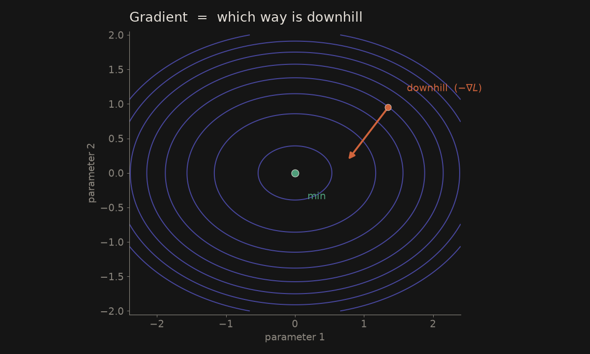{.lightbox width=90% fig-align="center"}
:::

::: {.callout-tip}
# Everyday example

You are on the top of a hill, and the next step will make you go down. What is the gradient of this step, the direction of this step? This movement is very important. It's easy.
:::

**Analogy.** You are standing on a hill in the fog. The gradient points *uphill*. To reduce the loss, take a step the other way.

**A tiny example.** Let $L(w)=(w-3)^2$. At $w=5$, the slope is $2(w-3)=4$. A descent step moves left: $w\leftarrow 5-0.1\times 4=4.6$, closer to $3$.

```python
w, lr, grad = 5.0, 0.1, 4.0
w = w - lr * grad   # 4.6
```

**Where it shows up.** Gradient descent, and every backward pass. The [learning loop](/foundations/ml-learning-loop.qmd) is that nudge, repeated. See [Calculus essentials](maths-calculus.qmd) and the [gradient primer](/ann/ann-activation-functions.qmd#a-gradient-primer).

# $\mathbb{E}$ — expectation

**In one line.** What is the average value over all possible outcomes, weighted by probability?

::: {.light-only}
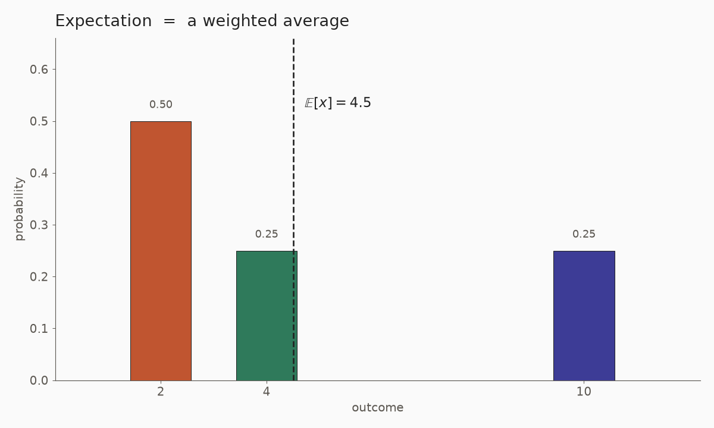{.lightbox width=90% fig-align="center"}
:::

::: {.dark-only}
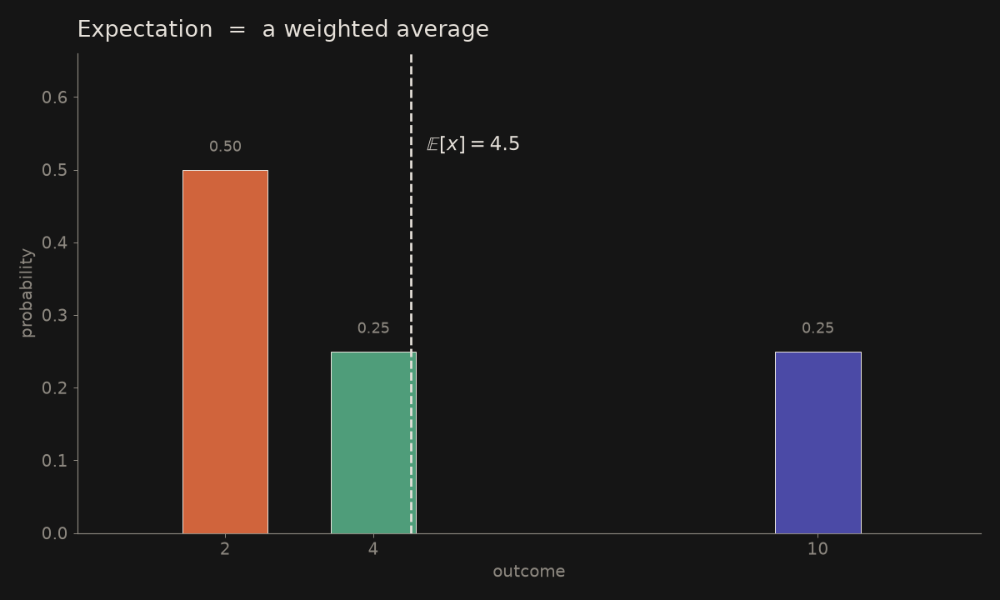{.lightbox width=90% fig-align="center"}
:::

::: {.callout-tip}
# Everyday example

If you take the same bus every morning, some days it is early and some days it is late. The expectation is the average time you would see if you did this for many mornings — not any single day. A loss in a model is the same idea: the average error over many examples.
:::

**Analogy.** The long-run average if you repeated the same random experiment many times. A fair die has expectation $3.5$, even though $3.5$ never appears on a face.

**A tiny example.** Outcomes $2$, $4$, $10$ with probabilities $0.5$, $0.25$, $0.25$: $\mathbb{E}[x]=2\cdot 0.5+4\cdot 0.25+10\cdot 0.25=4.5$.

```python
import numpy as np
x, p = np.array([2.0, 4.0, 10.0]), np.array([0.5, 0.25, 0.25])
np.dot(x, p)   # 4.5
```

**Where it shows up.** A loss is often an expectation — the average error over data. See [Probability and statistics](maths-probability.qmd).

# $\odot$ — element-wise multiplication

**In one line.** Multiply corresponding entries, not entire matrices.

::: {.light-only}
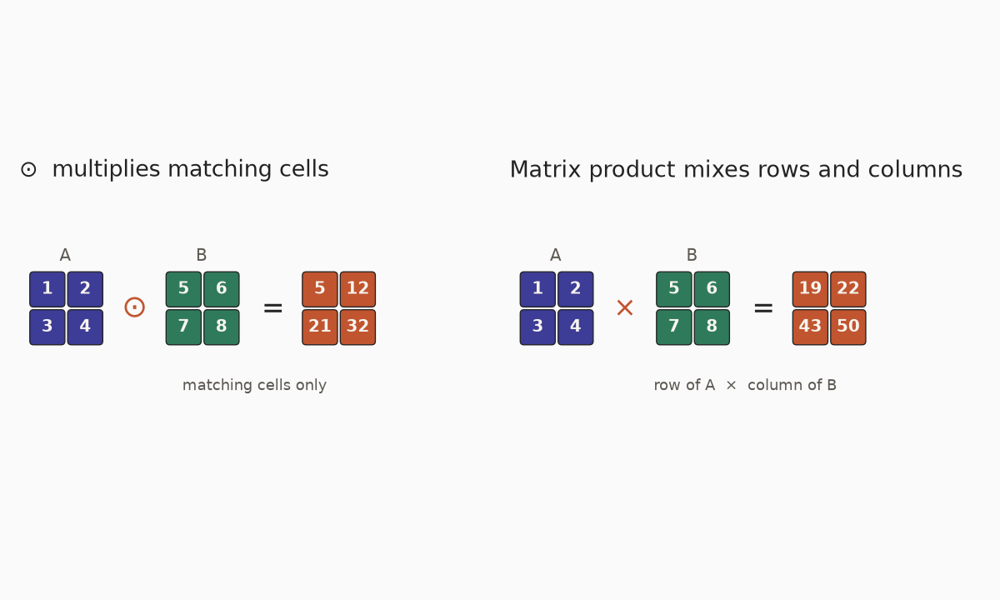{.lightbox width=100% fig-align="center"}
:::

::: {.dark-only}
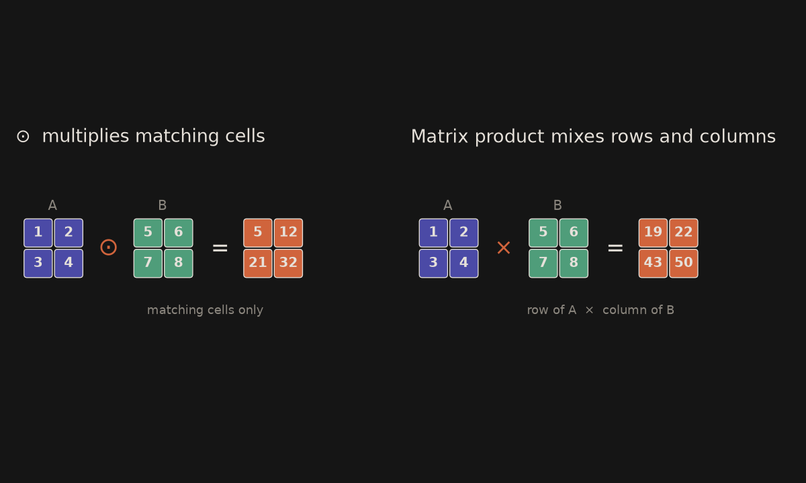{.lightbox width=100% fig-align="center"}
:::

::: {.callout-tip}
# Everyday example

You have a shopping list and a "how many I already have" list, item by item: apples with apples, milk with milk. You never mix the apple line with the milk line. In a network, a gate does the same: it keeps or kills each number in its own place.
:::

**Analogy.** Two shopping lists, item by item. You never mix the apple row with the orange row — that mix would be a *matrix* product.

**A tiny example.** $(1,2,3)\odot(4,5,6)=(4,10,18)$.

```python
import numpy as np
np.array([1, 2, 3]) * np.array([4, 5, 6])   # [4, 10, 18]
```

**Where it shows up.** LSTM gates (forget gate $\odot$ cell state), attention masks, and any “keep or kill this entry” operation. See [Linear algebra essentials](maths-linear-algebra.qmd).

# $\lVert\cdot\rVert$ — norm

**In one line.** How big is a vector or an error?

::: {.light-only}
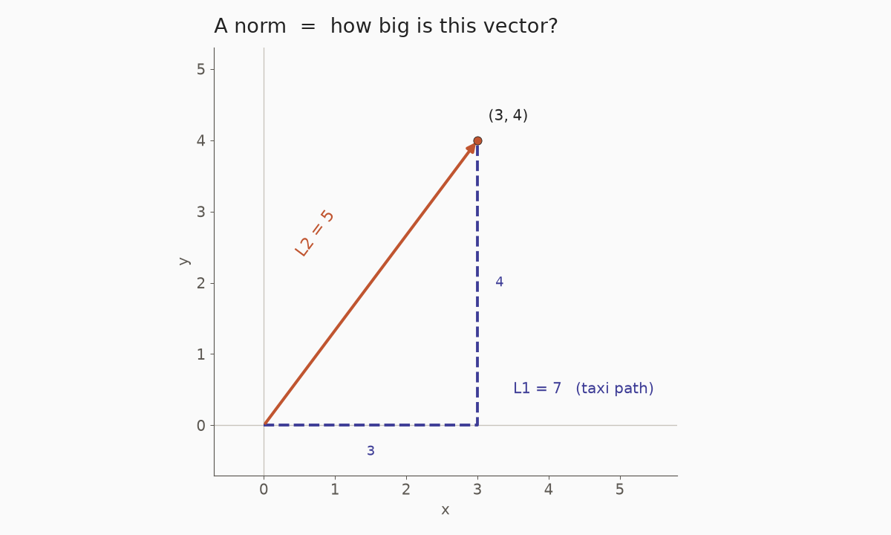{.lightbox width=90% fig-align="center"}
:::

::: {.dark-only}
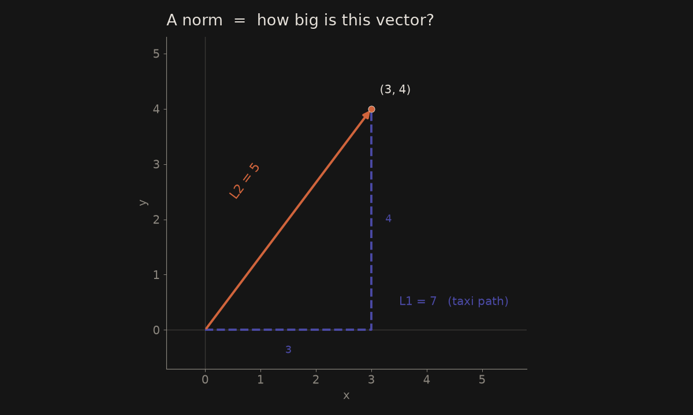{.lightbox width=90% fig-align="center"}
:::

::: {.callout-tip}
# Everyday example

To the shop, you can cut across the park (the straight path) or walk the street corners like a taxi. Both answer "how far is it?" — one as a straight line, one as the blocks you actually walk. In ML, a norm asks how big a vector or an error is.
:::

**Analogy.** The length of an arrow. The everyday **L2** (Euclidean) norm is the straight-line distance, the same rule as Pythagoras. The **L1** norm is the taxi-city walk, along the axes.

**A tiny example.** For $v=(3,4)$, $\lVert v\rVert_2=\sqrt{3^2+4^2}=5$ and $\lVert v\rVert_1=3+4=7$. A loss often uses the *squared* L2 norm, $25$, so the square root can be skipped.

```python
import numpy as np
np.linalg.norm([3.0, 4.0])   # 5.0
```

**Where it shows up.** Distance to a cluster centre (k-means inertia), L2 regularisation $\lambda\lVert w\rVert^2$, and “how large is this error?”. See [k-means](/algorithms/algo-k-means.qmd#the-objective-inertia-or-wcss) and [Linear algebra essentials](maths-linear-algebra.qmd).

# $\arg\max$ — argmax

**In one line.** Which input gives the highest value?

::: {.light-only}
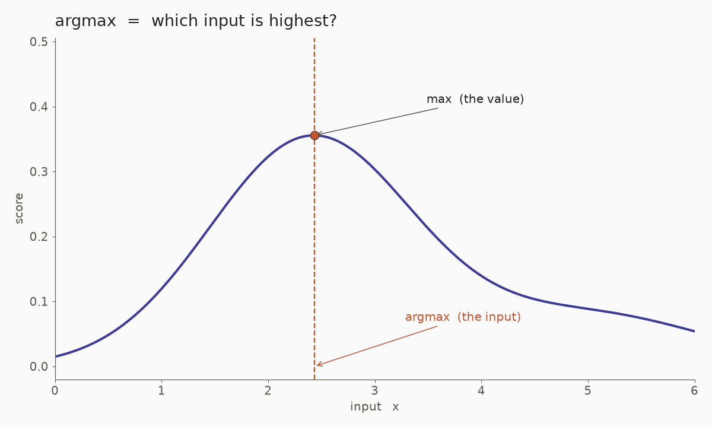{.lightbox width=90% fig-align="center"}
:::

::: {.dark-only}
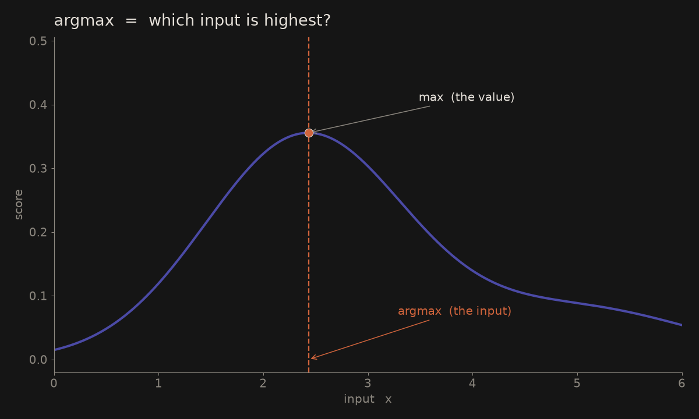{.lightbox width=90% fig-align="center"}
:::

::: {.callout-tip}
# Everyday example

The league table shows the scores, but what you care about is *which team* finished first, not only how many points they got. That "which one?" is argmax. A classifier does the same: it picks the class with the highest score.
:::

**Analogy.** Not “how high did the class score?”, but “**which class** won?”.

**A tiny example.** Scores $(0.1, 0.7, 0.2)$: the maximum is $0.7$, and $\arg\max$ is index $1$ (the second class, counting from $0$).

```python
import numpy as np
np.argmax([0.1, 0.7, 0.2])   # 1
```

**Where it shows up.** The predicted class in a classifier: take the output scores (or a softmax) and return $\arg\max$.

# A few more that complete the set

# $\Sigma$ — summation

**In one line.** Add these terms up.

::: {.light-only}
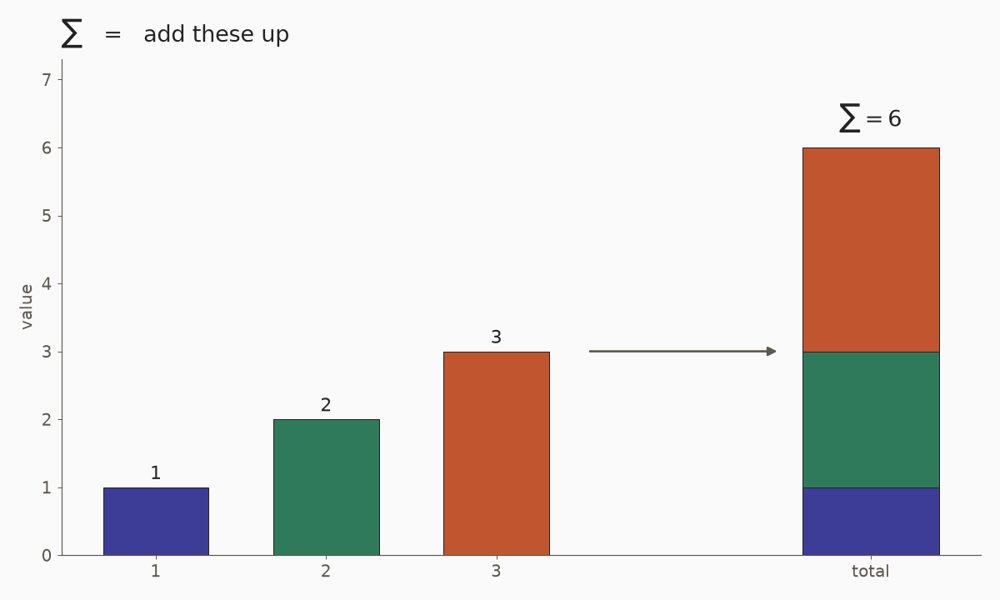{.lightbox width=90% fig-align="center"}
:::

::: {.dark-only}
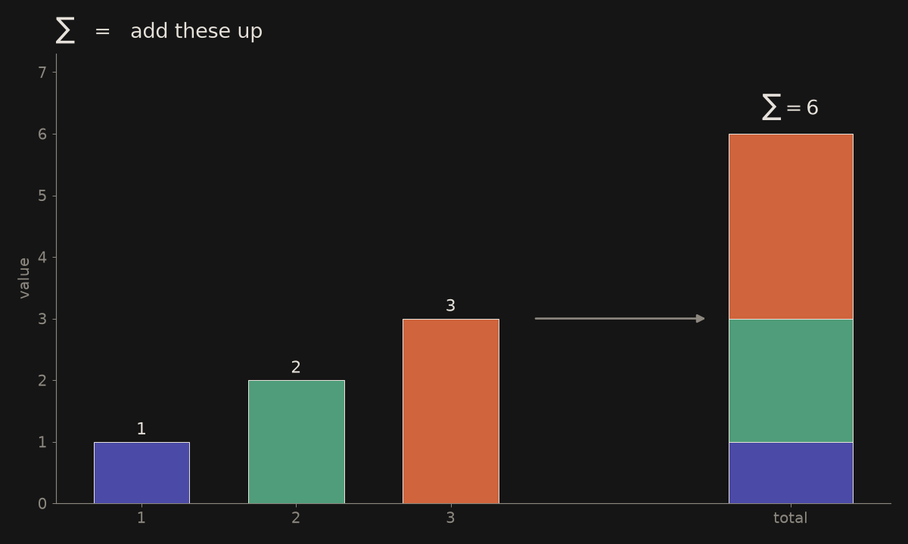{.lightbox width=90% fig-align="center"}
:::

::: {.callout-tip}
# Everyday example

At the till, you add every line on the receipt to get the total. Sigma is just that: plus, plus, plus, written small. Almost every loss adds up the errors in the same way.
:::

**Analogy.** A running total. The sigma sign is a compact “plus, plus, plus”.

**A tiny example.** $\sum_{i=1}^{3} i = 1+2+3=6$. A mean is just a sum divided by the count: $(1+2+3)/3=2$.

```python
import numpy as np
np.sum([1, 2, 3])   # 6
```

**Where it shows up.** Almost every loss and every mean: inertia, cross-entropy, sum of squared errors.

# $\prod$ — product

**In one line.** Multiply these terms together.

::: {.light-only}
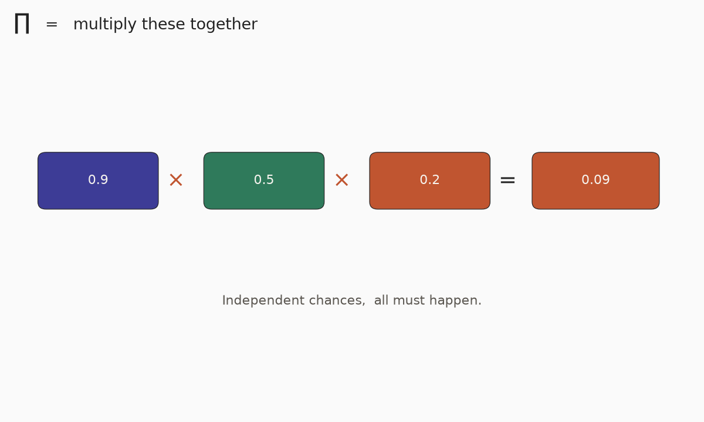{.lightbox width=90% fig-align="center"}
:::

::: {.dark-only}
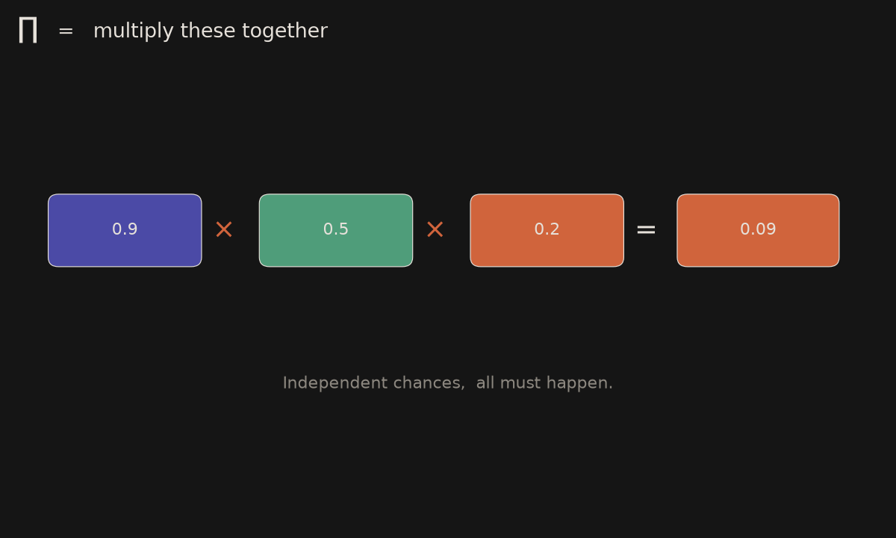{.lightbox width=90% fig-align="center"}
:::

::: {.callout-tip}
# Everyday example

Three locks on a bike: the bike is free only if lock 1 *and* lock 2 *and* lock 3 are open. When the steps are independent, you multiply the chances. That is how a naïve likelihood treats independent clues.
:::

**Analogy.** A chain of “and”s: the chance that several *independent* things all happen is the product of their chances.

**A tiny example.** $0.9\times 0.5\times 0.2=0.09$.

```python
import numpy as np
np.prod([0.9, 0.5, 0.2])   # 0.09
```

**Where it shows up.** The likelihood of independent events, and the “naïve” product inside [Naïve Bayes](/algorithms/algo-naive-bayes.qmd). Long products of probabilities get tiny, which is why we usually take a $\log$ next.

# $\log$ — logarithm

**In one line.** Turn a product into a sum, and stretch small probabilities so they are easier to add and to compare.

::: {.light-only}
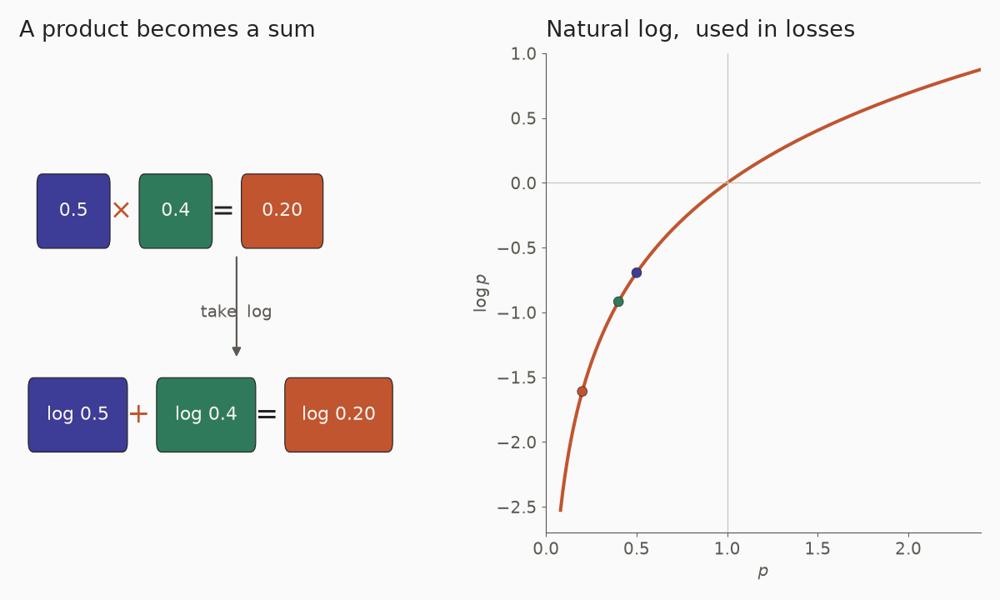{.lightbox width=100% fig-align="center"}
:::

::: {.dark-only}
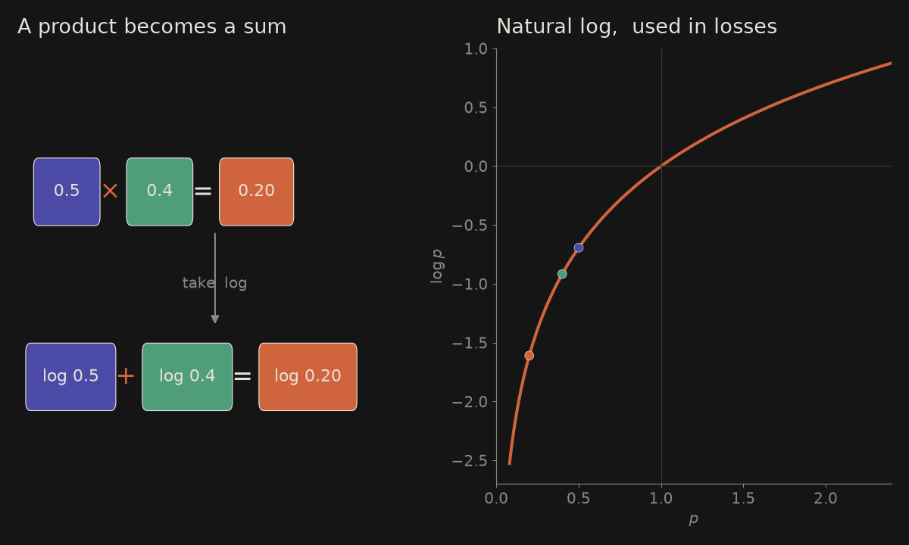{.lightbox width=100% fig-align="center"}
:::

::: {.callout-tip}
# Everyday example

A few small chances in a row — you catch the bus, the shop is open, they still have milk — make a tiny number when you multiply them, hard to read at a glance. A log turns those "times" into "plus", so you can add them up calmly. That is why training often uses a log-likelihood or a cross-entropy.
:::

**Analogy.** A translator: “times” becomes “plus”. That is why we talk about *log*-likelihood instead of multiplying many tiny numbers (which would underflow).

**A tiny example.** $\log(0.5\times 0.4)=\log 0.5+\log 0.4=\log 0.20$. NumPy’s `np.log` is the natural log.

```python
import numpy as np
np.log(0.5) + np.log(0.4)   # same as np.log(0.5 * 0.4)
```

**Where it shows up.** Log-likelihood, cross-entropy $-\log p$, and log-softmax. See [Probability and statistics](maths-probability.qmd).

# $\partial$ — partial derivative

**In one line.** How fast does this function change if I move *only this* input and hold the others still?

::: {.light-only}
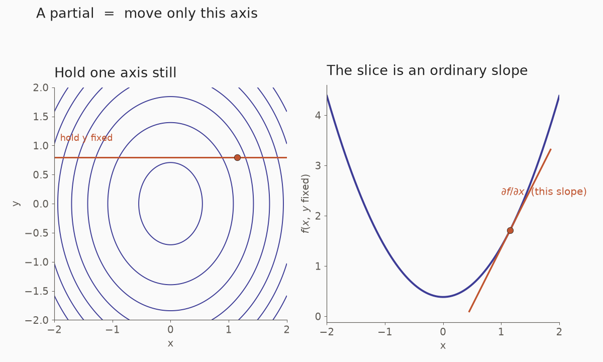{.lightbox width=100% fig-align="center"}
:::

::: {.dark-only}
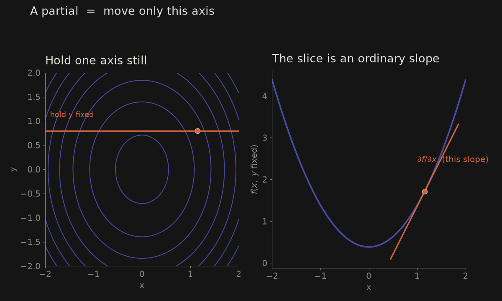{.lightbox width=100% fig-align="center"}
:::

::: {.callout-tip}
# Everyday example

On a shower, you can turn only the temperature and leave the flow alone. The partial derivative asks: if I move *just this* knob, how fast does the water change? In a network, each weight is one knob; the gradient is the list of all those answers.
:::

**Analogy.** A kitchen with two knobs, heat and time. The partial with respect to heat asks: if I turn only the heat, how fast does the cake change?

**A tiny example.** $f(x,y)=x^2+3y$. At $(2,1)$, $\partial f/\partial x=2x=4$ and $\partial f/\partial y=3$. The gradient is the vector of both: $\nabla f=(4,3)$.

```python
h = 1e-6
((2+h)**2 + 3*1 - (2**2 + 3*1)) / h   # about 4
```

**Where it shows up.** A network has many parameters. The gradient $\nabla$ is just the list of all these partials. See [Calculus essentials](maths-calculus.qmd).

# $\sigma$ — a letter with two common lives

**In one line.** Look at the context: $\sigma$ may be the **sigmoid** function, or the **standard deviation**.

::: {.light-only}
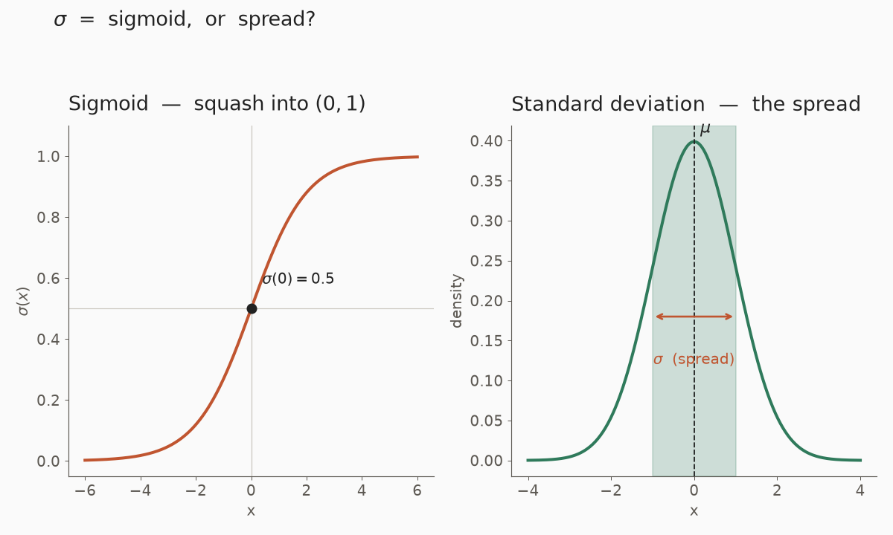{.lightbox width=100% fig-align="center"}
:::

::: {.dark-only}
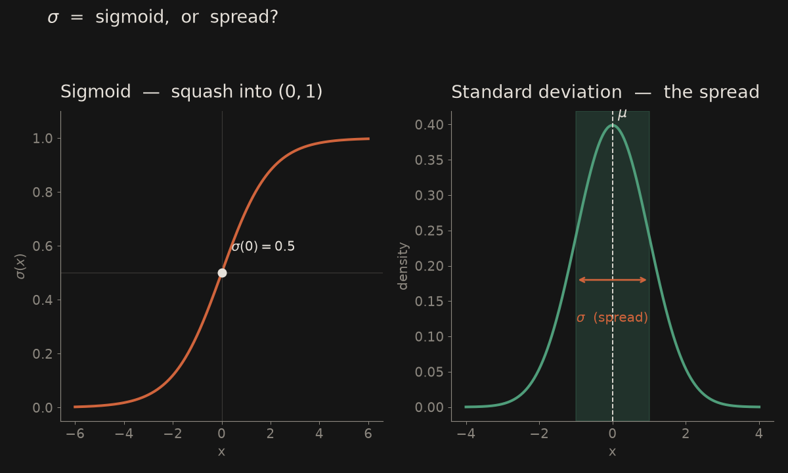{.lightbox width=100% fig-align="center"}
:::

::: {.callout-tip}
# Everyday example

The same letter has two everyday jobs, so look at the room you are in. As a dimmer, it squashes a signal to something between off and on — that is the sigmoid in a network. As a spread, it is how much your commute time jumps around from day to day — that is the standard deviation.
:::

**Analogy.** The same nickname for two classmates. In a network diagram, $\sigma$ usually means “squash this number into $(0,1)$”. In a statistics paragraph, $\sigma$ is “how spread out is this data?”.

**A tiny example.** The sigmoid at $0$ is $\sigma(0)=1/(1+e^{0})=0.5$. The standard deviation of $[2,4]$ (population) is $1$, because the mean is $3$ and each value sits $1$ away.

```python
import numpy as np
1 / (1 + np.exp(0))      # sigmoid(0) = 0.5
np.std([2.0, 4.0])       # 1.0  (NumPy's default is the population std)
```

**Where it shows up.** Sigmoid activations and LSTM gates (see [Activation functions](/ann/ann-activation-functions.qmd)); standard deviation in data summaries and in the normal distribution (see [Probability and statistics](maths-probability.qmd)).

# $^\top$ and the dot product

**In one line.** $^\top$ flips rows and columns; the dot product $u^\top v$ (or $u\cdot v$) multiplies matching entries and adds them up.

::: {.light-only}
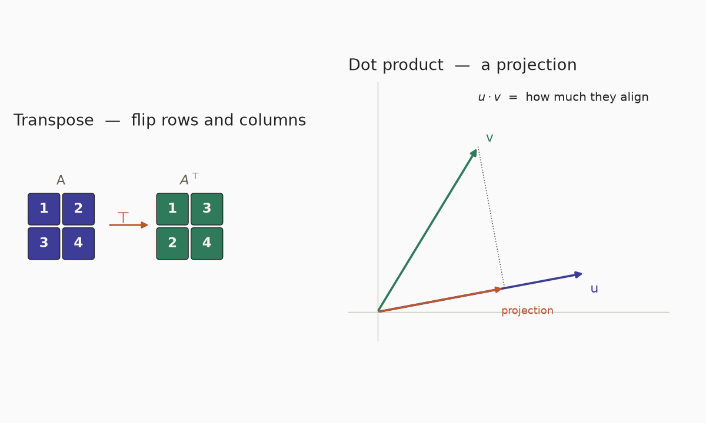{.lightbox width=100% fig-align="center"}
:::

::: {.dark-only}
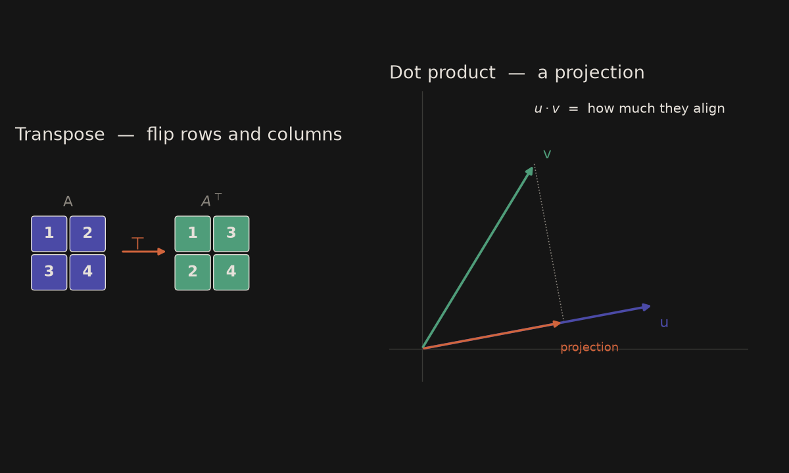{.lightbox width=100% fig-align="center"}
:::

::: {.callout-tip}
# Everyday example

Turning a table on its side is a transpose: rows become columns, like flipping a seating plan. The dot product is a shopping moment: price times quantity for each item, then add — your total, and also the weighted sum inside a neuron.
:::

**Analogy.** Transpose is turning a table on its corner. The dot product is “how much do these two arrows point the same way?” — or, in a neuron, a weighted sum of inputs.

**A tiny example.** $(1,2)\cdot(3,4)=1\cdot 3+2\cdot 4=11$. The transpose of $\begin{pmatrix}1&2\\3&4\end{pmatrix}$ is $\begin{pmatrix}1&3\\2&4\end{pmatrix}$.

```python
import numpy as np
np.dot([1, 2], [3, 4])          # 11
np.array([[1, 2], [3, 4]]).T    # [[1, 3], [2, 4]]
```

**Where it shows up.** Almost every layer: $x^\top w$, or a batch written as $Xw$. See [Linear algebra essentials](maths-linear-algebra.qmd).

# $\in$ — belongs to

**In one line.** Does this object belong to that set?

::: {.light-only}
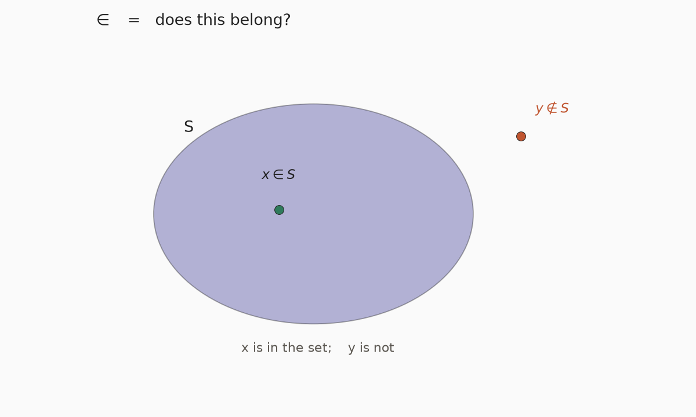{.lightbox width=90% fig-align="center"}
:::

::: {.dark-only}
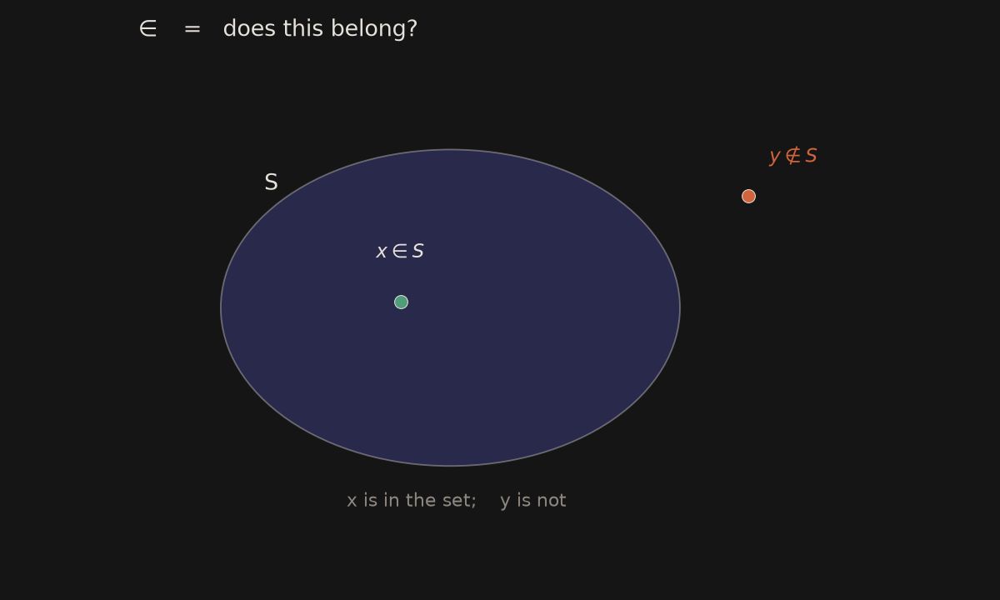{.lightbox width=90% fig-align="center"}
:::

::: {.callout-tip}
# Everyday example

Is this key on your keyring, or not? Belongs-to is a simple membership check. In ML it is the same idea: this label belongs to the set of classes, this vector belongs to the space of inputs.
:::

**Analogy.** A membership badge. $x\in\mathbb{R}^n$ means “$x$ is a real vector with $n$ entries”.

**A tiny example.** $3\in\{1,2,3\}$, but $4\notin\{1,2,3\}$. A paper will write a weight matrix as $W\in\mathbb{R}^{d\times k}$.

```python
3 in {1, 2, 3}   # True
```

**Where it shows up.** Shapes and spaces: $x\in\mathbb{R}^n$, a label $y\in\{1,\ldots,K\}$.

# $\approx$ and $\propto$ — approximately, proportional to

**In one line.** $\approx$ means “almost equal”; $\propto$ means “moves in proportion to” (the same shape, maybe a different scale).

::: {.light-only}
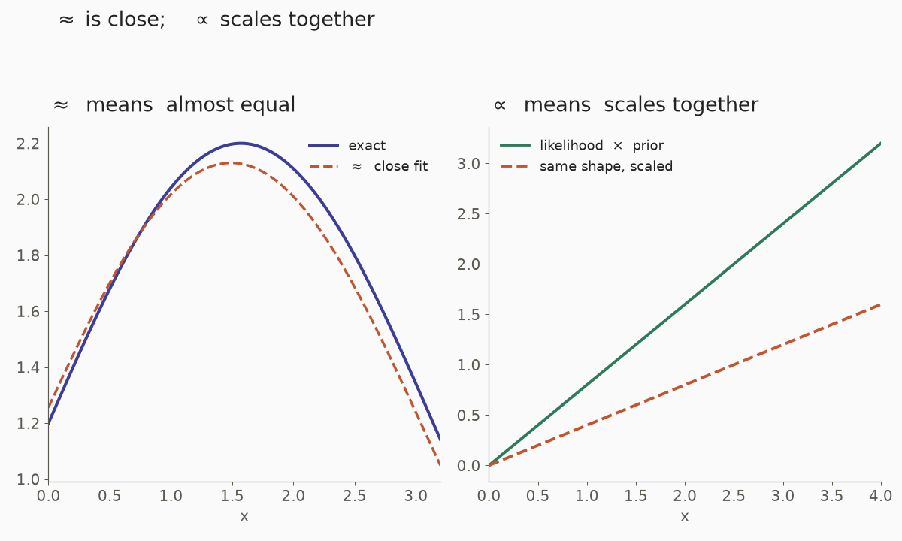{.lightbox width=100% fig-align="center"}
:::

::: {.dark-only}
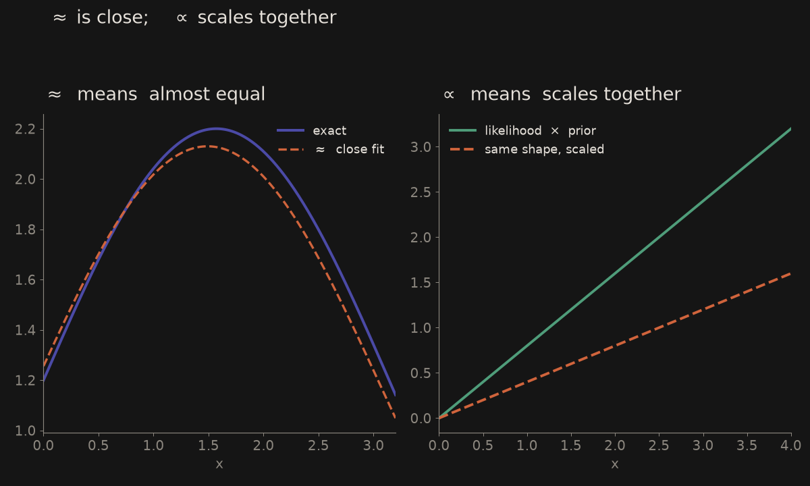{.lightbox width=100% fig-align="center"}
:::

::: {.callout-tip}
# Everyday example

The recipe says "about 180 degrees" — that is approximately, close enough. If you double the guests, you double the flour — that is proportional, the same shape at a new scale. Models use both: a handy approximation, or a posterior that follows likelihood times prior.
:::

**Analogy.** $\approx$ is a close hug, not a perfect match. $\propto$ is “when this doubles, that doubles” — a constant factor may still be hiding.

**A tiny example.** $\pi\approx 3.14$. In Bayes, the posterior is $\propto$ likelihood $\times$ prior (the missing piece is the normaliser $P(\text{data})$).

```python
import numpy as np
np.isclose(22 / 7, 3.14, atol=0.02)   # True, roughly
# unnormalised posterior:
# posterior_unnorm = likelihood * prior
```

**Where it shows up.** Approximations such as $\operatorname{GELU}(x)\approx x\cdot\sigma(1.702x)$, and Bayes in [Probability and statistics](maths-probability.qmd).

# $P(A\mid B)$ — conditional probability

**In one line.** What is the chance of $A$, given that we already know $B$?

::: {.light-only}
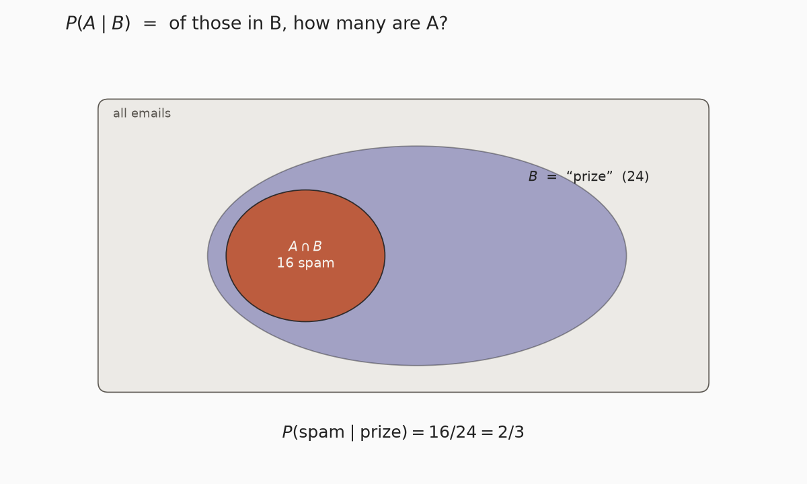{.lightbox width=90% fig-align="center"}
:::

::: {.dark-only}
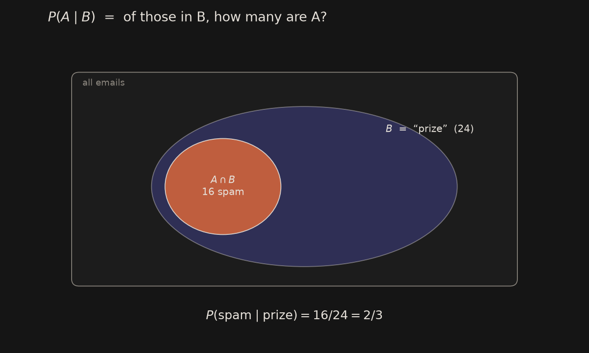{.lightbox width=90% fig-align="center"}
:::

::: {.callout-tip}
# Everyday example

You already know it is raining. Now, what is the chance you will want a coat? That is "given B, what about A?" — you have narrowed the question to the rainy days. A spam filter does the same: given this word, how likely is spam?
:::

**Analogy.** Of all the emails that contain “prize”, what fraction are spam? You have already narrowed the pile to $B$.

**A tiny example.** $100$ emails, $20$ of them spam. The word “prize” appears in $16$ of the spam emails and in $8$ of the rest, so in $24$ emails altogether: $P(\text{spam}\mid\text{prize})=16/24=2/3$.

```python
16 / 24   # 2/3
```

**Where it shows up.** Conditioning, Bayes, and [Naïve Bayes](/algorithms/algo-naive-bayes.qmd). The same example is worked on the [probability](maths-probability.qmd) page.

# $\arg\min$ and $\min$ — the training question

**In one line.** $\min$ is the smallest value; $\arg\min$ is *which input* gives that smallest value. Training is $\arg\min$ of the loss.

::: {.light-only}
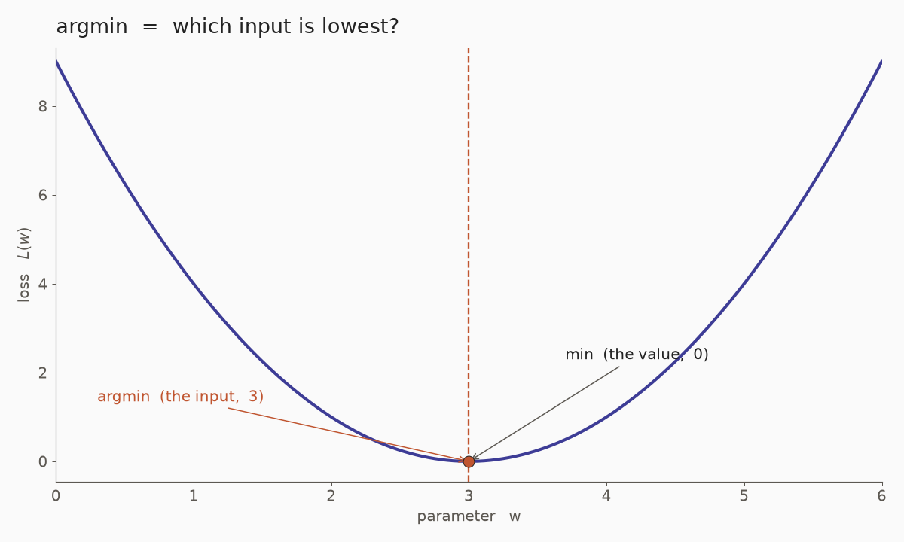{.lightbox width=90% fig-align="center"}
:::

::: {.dark-only}
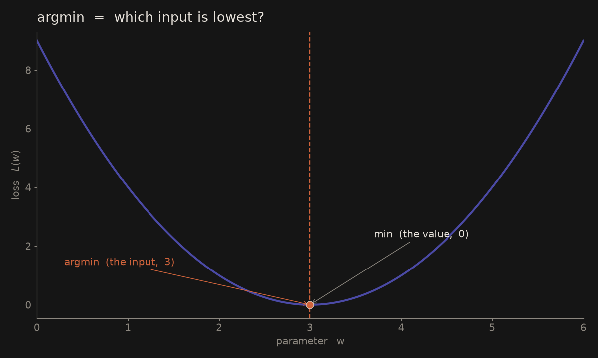{.lightbox width=90% fig-align="center"}
:::

::: {.callout-tip}
# Everyday example

You are buying a phone. The lowest price is the min; *which* phone has that price is the argmin. Training is the same question: which parameters make the error as small as it can be?
:::

**Analogy.** The lowest point on the hill ($\min$) versus “where do I stand to be at the bottom?” ($\arg\min$). The twin of $\arg\max$.

**A tiny example.** For $L(w)=(w-3)^2$, the minimum value is $0$ and $\arg\min_w L(w)=3$. Training writes $\theta^\star=\arg\min_\theta L(\theta)$.

```python
import numpy as np
ws = np.linspace(0, 6, 7)
ws[np.argmin((ws - 3)**2)]   # 3.0
```

**Where it shows up.** Every training loop: find the parameters that minimise the loss. Prediction often uses $\arg\max$; learning uses $\arg\min$.

# MSE — mean squared error

**In one line.** How wrong are we, on average? Square every error, then take the mean.

$$
\text{MSE} = \frac{1}{n}\sum_{i=1}^{n} (\hat{y}_i - y_i)^2
$$

Read it right to left: for each example $i$, take the prediction $\hat{y}_i$ minus the real answer $y_i$, square it, add them all up ($\Sigma$) and divide by how many there are ($\frac{1}{n}$).

::: {.light-only}
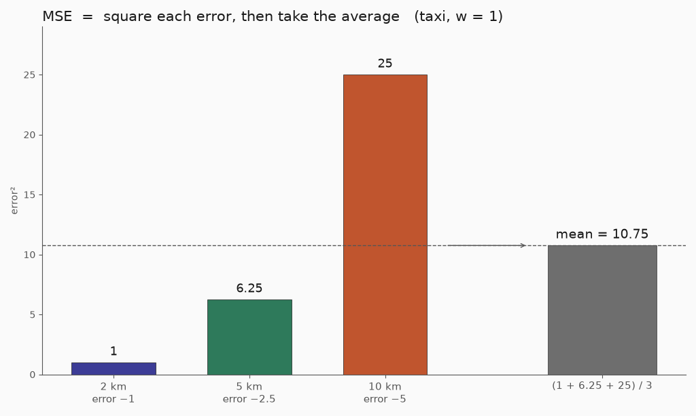{.lightbox width=90% fig-align="center"}
:::

::: {.dark-only}
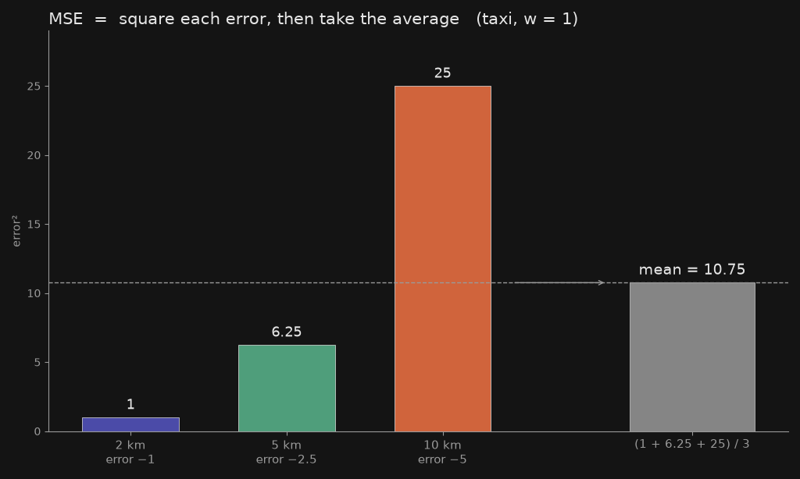{.lightbox width=90% fig-align="center"}
:::

::: {.callout-tip}
# Everyday example

You play darts and throw three. Measure how far each dart lands from the bullseye, square each distance, and average. One wild throw far from the centre ruins your score much more than three throws that are a bit off. That number is your MSE: lower is better, and 0 means every dart hit the bullseye.
:::

**Analogy.** A penalty score. Small misses cost a little, big misses cost a lot, and above or below costs the same.

**A tiny example.** Taxi receipts 2 km for €3, 5 km for €7.50 and 10 km for €15, with a guess $w=1$: predictions 2, 5, 10; errors −1, −2.5, −5; squared 1, 6.25, 25; mean $32.25/3 = 10.75$. With $w=1.5$ every error is 0, so MSE $=0$.

```python
km    = [2, 5, 10]
price = [3, 7.5, 15]
w = 1
errors = [w * x - y for x, y in zip(km, price)]
sum(e * e for e in errors) / len(km)   # 10.75
```

**Where it shows up.** The loss of linear regression and most regression models; the number gradient descent pushes down in [Taxi Lab 1](../mlab01-1.qmd).

# Summary

| Symbol | Pronunciation | The question it asks | A typical ML home |
| --- | --- | --- | --- |
| $\nabla$ | nabla, gradient | Which way should the parameters move to reduce the loss? | Gradient descent, backprop |
| $\mathbb{E}$ | expectation | What is the probability-weighted average? | Losses as averages over data |
| $\odot$ | Hadamard, element-wise times | Multiply matching entries? | Gates, attention masks |
| $\lVert\cdot\rVert$ | norm | How big is this vector or error? | L2 regularisation, k-means inertia |
| $\arg\max$ | argmax | Which input gives the highest value? | Predicted class |
| $\Sigma$ | sigma, sum | Add these terms up? | Every mean and every loss |
| $\prod$ | pi, product | Multiply these terms together? | Independent likelihoods |
| $\log$ | log | Turn a product into a sum? | Log-likelihood, cross-entropy |
| $\partial$ | partial | How does $f$ change if only this input moves? | The pieces of $\nabla$ |
| $\sigma$ | sigma | Sigmoid, or standard deviation? | Activations, or spread |
| $^\top$ / $\cdot$ | transpose / dot | Flip the table; or weighted sum? | Layers, $x^\top w$ |
| $\in$ | in, belongs to | Does this object belong to that set? | $x\in\mathbb{R}^n$, label sets |
| $\approx$ / $\propto$ | approx. / proportional | Almost equal? Or the same shape, scaled? | Approximations; Bayes |
| $P(A\mid B)$ | probability of A given B | Of those in $B$, how many are $A$? | Conditioning, naïve Bayes |
| $\arg\min$ / $\min$ | argmin / min | Which input gives the smallest value? | Training: minimise the loss |
| MSE | mean squared error | How wrong are we, on average? | Regression loss, Taxi Lab |

# See also

- [Maths for machine learning](maths-index.qmd)
- [Linear algebra essentials](maths-linear-algebra.qmd)
- [Calculus essentials](maths-calculus.qmd)
- [Probability and statistics essentials](maths-probability.qmd)
- [Optimization essentials](maths-optimization.qmd)
