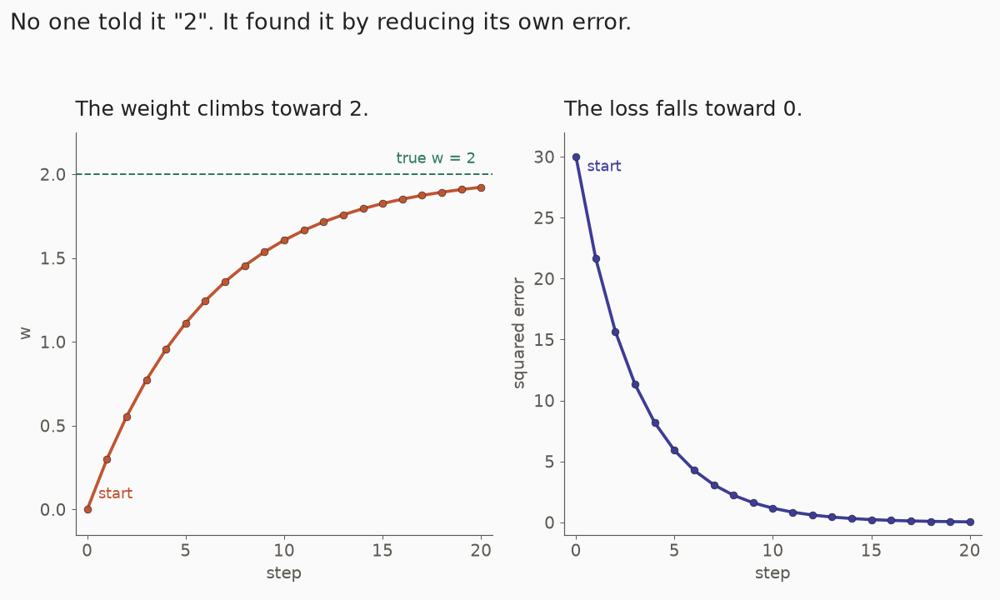
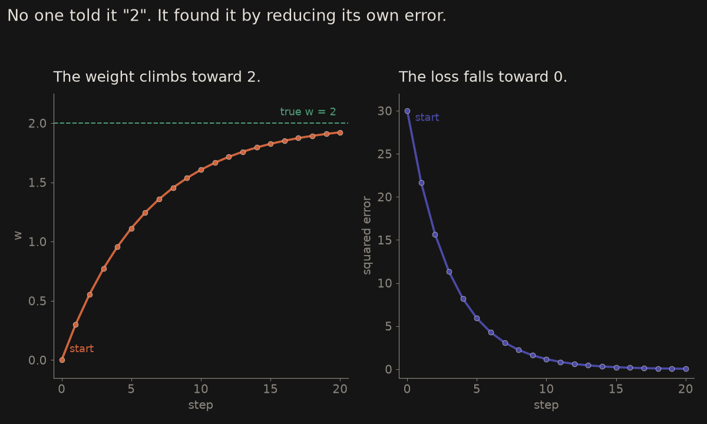

# The simplest model

The simplest model is a single weight: $y = w \cdot x$. We give it data where the true answer is $w = 2$ ($y$ is always $2\times x$) and watch it find that on its own.

# The learning loop

1. **Guess:** start with $w = 0$.
2. **Predict:** compute $w \cdot x$ for each example.
3. **Measure the error:** how far off are the predictions? (squared error)
4. **Nudge** $w$ in the direction that reduces the error (the derivative says which way).
5. **Repeat.**

::: {.callout-tip}
# Everyday example

You season a soup. Taste it: too little salt. Add a pinch, taste again. You do not dump the whole shaker — that would ruin it. That pinch is the learning rate; tasting and nudging, over and over, is how a model learns.
:::

```{mermaid}
flowchart TD
  A[Start with a guess] --> B[Predict]
  B --> C[Measure the squared error]
  C --> D[Nudge the weight]
  D --> B
```

# The code

The data is $x=\{1,2,3,4\}$ and $y=\{2,4,6,8\}$. The learning rate is $0.01$, for $20$ steps.

::: {.panel-tabset}

## Java

```java
public class Learn {
    public static void main(String[] args) {
        double[] x = {1, 2, 3, 4};
        double[] y = {2, 4, 6, 8};   // y = 2 * x
        double w = 0;                // initial guess
        double lr = 0.01;            // learning rate (step size)

        for (int step = 0; step < 20; step++) {
            double grad = 0, loss = 0;
            for (int i = 0; i < x.length; i++) {
                double err = w * x[i] - y[i];
                loss += err * err;
                grad += 2 * err * x[i];   // derivative of err² with respect to w
            }
            loss /= x.length;
            grad /= x.length;

            w -= lr * grad;              // the learning step
            System.out.printf("step %d  w=%.3f  loss=%.4f%n", step, w, loss);
        }
    }
}
```

## Python

```python
x = [1, 2, 3, 4]
y = [2, 4, 6, 8]   # y = 2 * x
w = 0.0            # initial guess
lr = 0.01          # learning rate (step size)

for step in range(20):
    grad = 0.0
    loss = 0.0
    for i in range(len(x)):
        err = w * x[i] - y[i]
        loss += err * err
        grad += 2 * err * x[i]   # derivative of err**2 with respect to w
    loss /= len(x)
    grad /= len(x)
    w -= lr * grad               # the learning step
    print(f"step {step}  w={w:.3f}  loss={loss:.4f}")
```

:::

# What you'll see

$w$ starts at $0$, jumps to $0.3$ after the first step, then climbs toward $2$ while the loss shrinks toward $0$. That is learning: no one told it "$2$", it found it by repeatedly reducing its own error.

A real run of the program above prints this (the loss on each line is the error *before* that step's nudge):

```
step 0  w=0.300  loss=30.0000
step 1  w=0.555  loss=21.6750
step 2  w=0.772  loss=15.6602
step 3  w=0.956  loss=11.3145
step 4  w=1.113  loss=8.1747
...
step 18  w=1.909  loss=0.0863
step 19  w=1.922  loss=0.0624
```

After twenty steps, $w$ is $1.922$, already close to $2$.

::: {.light-only}
{.lightbox width=100% fig-align="center"}
:::

::: {.dark-only}
{.lightbox width=100% fig-align="center"}
:::

# Try this

Change `lr` and run it again. The step size really matters.

- `lr = 0.001` — slow learning. After twenty steps, $w$ is only $0.522$ and the printed loss is still $16.8927$.
- `lr = 0.1` — the first nudge overshoots: $w$ jumps to $3.000$, then zig-zags ($1.500$, $2.250$, $1.875$, \ldots) but it still converges, and faster than $0.01$.
- `lr = 0.2` — it blows up. $w$ goes $6$, $-6$, $18$, $-30$, and the loss keeps growing.

```
# lr = 0.1
step 0  w=3.000  loss=30.0000
step 1  w=1.500  loss=7.5000
step 2  w=2.250  loss=1.8750
step 3  w=1.875  loss=0.4688

# lr = 0.2
step 0  w=6.000  loss=30.0000
step 1  w=-6.000  loss=120.0000
step 2  w=18.000  loss=480.0000
```

The nudge itself is the same idea as on the [optimization](maths/maths-optimization.qmd) page: $w \leftarrow w - \eta\nabla L$. The [gradient](maths/maths-symbols.qmd#nabla-gradient) says which way.

# The same loop, more weights

Every neural network, including an MNIST classifier, is this same loop with many more weights.

# Next step: a bias

Next step would be adding a bias: $y = w\cdot x + b$. Now two numbers have to be learned, not one, but the loop does not change: predict, measure the error, nudge each parameter, repeat.

# See also

- [ML math symbols, explained easy](maths/maths-symbols.qmd) — $\nabla$, $\arg\min$
- [Optimization essentials](maths/maths-optimization.qmd) — the update, the learning rate, momentum, and Adam
- [Calculus essentials](maths/maths-calculus.qmd) — the slope and one step of gradient descent
- [What is Machine Learning](/machine/machine-index.qmd) — the decision / error / optimisation loop, and the four learning paradigms
- [Maths for machine learning](maths/maths-index.qmd)
