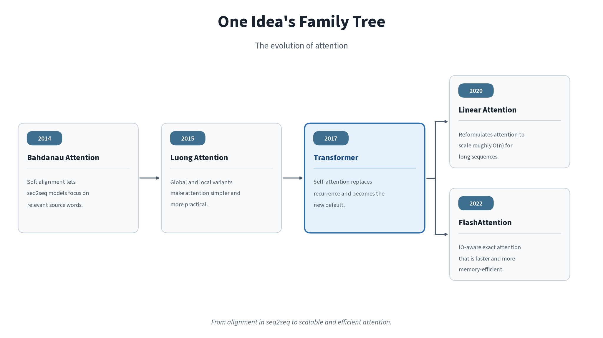
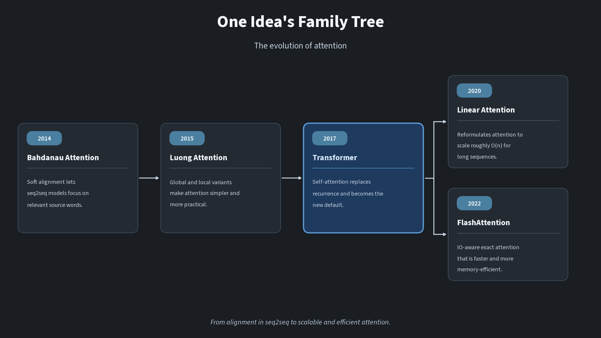

# One idea that changed deep learning forever

One idea that changed deep learning forever: attention.

Before that idea, a typical neural translator read a source sentence and squeezed it into one fixed-length vector. A decoder then tried to write the whole translation from that single summary. It is like packing a long letter into one sticky note, and answering with only the note in front of you. The longer the letter, the more the early sentences fade. That squeeze is the seq2seq bottleneck.

This page walks the family tree of the idea that opened the letter back up.

- **2014:** [Bahdanau](https://arxiv.org/abs/1409.0473){.external target="_blank"} introduced soft attention.
- **2015:** [Luong](https://arxiv.org/abs/1508.04025){.external target="_blank"} refined attention mechanisms.
- **2017:** [Transformers](https://arxiv.org/abs/1706.03762){.external target="_blank"} made self-attention the foundation.
- **2020:** [Linear attention](https://arxiv.org/abs/2006.16236){.external target="_blank"} tackled quadratic complexity.
- **2022:** [FlashAttention](https://arxiv.org/abs/2205.14135){.external target="_blank"} made exact attention faster and more memory-efficient.

The original Transformer figure already lives on the [Generative AI overview](generative-index.qmd). A 3Blue1Brown walk-through of the same architecture is on [ANN: model and demos](/ann/ann-model-and-demos.qmd). The teaching page for the Transformer itself is still [in progress](generative-transformer.qmd). Here we tell the story that leads to it, and the work that made attention practical at length.

::: {.light-only}
{.lightbox width=100% fig-align="center"}
:::

::: {.dark-only}
{.lightbox width=100% fig-align="center"}
:::

```{mermaid}
flowchart TD
  P["Seq2seq bottleneck: one fixed-length vector"] --> B["2014 Bahdanau: soft attention"]
  B --> L["2015 Luong: global, local, dot-product"]
  L --> T["2017 Transformer: self-attention as the foundation"]
  T --> C["The cost: O(n^2)"]
  C --> A["2020 Linear attention: about O(n)"]
  C --> F["2022 FlashAttention: exact, IO-aware, faster"]
```

# The bottleneck: one sticky note for a whole letter

Early neural translation models belonged to a family of encoder-decoders. An encoder read the source sentence and wrote a single fixed-length vector; a decoder generated the translation from that vector.

The trouble is the squeeze. A short greeting fits on a sticky note. A paragraph does not. By the time the decoder starts writing, the beginning of the source may already have faded. Bahdanau, Cho and Bengio conjectured that this fixed-length vector was a bottleneck, and they proposed to do something more natural: keep the source in view, and learn where to look.

::: {.callout-tip}
# Everyday example

You are answering a long email. If you first shrink it to one sticky note, then hide the email, you will lose the names, the dates, and the question in the first paragraph. Better to leave the email open on the desk and glance back at the line that matters for the sentence you are writing now.
:::

# 2014: Bahdanau and soft attention

[Neural Machine Translation by Jointly Learning to Align and Translate](https://arxiv.org/abs/1409.0473){.external target="_blank"} (Bahdanau, Cho and Bengio, posted in 2014) extends the encoder-decoder with a learned alignment.

At each word the decoder writes, the model looks at every encoder state — that is, at every position in the source — and gives each one a weight. The context for the new word is a weighted mix of those states, not a single pre-cooked summary.

The attention is **soft**: the model does not pick one source word with a hard yes or no. Every position gets a share, the shares add up to one, and the whole step is differentiable, so the network can learn the alignment by the ordinary [learning loop](/foundations/ml-learning-loop.qmd).

When the decoder writes *she*, the weights can rise on *Riya* and fall on *the* and *to*. The original letter stays on the desk.

# 2015: Luong refines the mechanism

[Effective Approaches to Attention-based Neural Machine Translation](https://arxiv.org/abs/1508.04025){.external target="_blank"} (Luong, Pham and Manning, 2015) asked a practical question: once you have attention, how should you score the look-up, and how widely should you look?

They describe two classes:

- **Global** attention still looks at all source words, as Bahdanau's model does.
- **Local** attention first chooses a place in the source, then looks in a window around it.

They also simplified the scoring. One of the options is a plain **dot product** between the decoder state and each source state — a cheaper relative of Bahdanau's additive score, and a step toward the scaled dot-product used in the Transformer.

::: {.callout-tip}
# Everyday example

Sometimes you reread the whole page. Sometimes you already know the answer is in the middle paragraph, so you only scan that window. Global attention is the first habit; local attention is the second.
:::

# How attention decides: the core formula

By 2017 the usual computation, written with matrices, is this:

$$
\operatorname{Attention}(Q, K, V) = \operatorname{softmax}\!\left(\frac{QK^{\top}}{\sqrt{d_k}}\right)V
$$

It looks dense. It is one everyday move, done with three views of each word.

- The **query** ($Q$) is the question you are asking. At *she*, the question is roughly "who is this person?"
- The **key** ($K$) is the label on every word, the thing you match against the question. *Riya* carries a label like "a person's name"; *went* carries a label like "an action".
- The **value** ($V$) is the content you actually take if the match is good.

The keys decide *where* to look. The values are *what* you bring back.

The formula does four small jobs, in order:

1. **Compare.** $QK^{\top}$ scores every query against every key. A large score means "this label answers that question well".
2. **Scale.** Divide by $\sqrt{d_k}$, the square root of the key size. Without that, as the vectors get longer the scores get larger, and softmax turns into a sharp spike that almost ignores everyone but the winner. The scaling keeps the mix soft enough to learn. That is the *scaled* in scaled dot-product attention.
3. **Turn scores into shares.** Softmax makes each row a set of weights that add up to 1. They are the attention weights: how much this word looks at each other word.
4. **Mix.** Multiply by $V$. The result for *she* is mostly the value of *Riya*, plus a little of the others.

::: {.callout-tip}
# Everyday example

You walk into a small library and ask, "who is she?" That question is the query. Each book has a label on the spine — the key. You compare your question with every label, spend most of your time on the biography of Riya, and almost none on a book about walking. What you carry out of the library is the content of the books, not the labels, mixed in those same proportions. That mix is the output.
:::

Here is a tiny numerical sketch, with three words — *she*, *Riya*, *went* — and two-dimensional toy vectors. These numbers are a classroom example, not a trained model. The query for *she* is lined up with the key for *Riya*, so the weights should favour *Riya*.

After the scores are scaled and passed through softmax, the weights on the *she* row are about **11.6%** on *she*, **78.2%** on *Riya*, and **10.2%** on *went*. *She* is mostly looking at *Riya*. The mixed value comes out close to Riya's own value, which is what we wanted.

The cell below is live Python in the browser. It uses only NumPy. Press Run if you want to change a number and watch the weights move.

```{pyodide}
#| autorun: true
import numpy as np

# A toy example, not a trained model.
# Three words: she, Riya, went. Each has a query, a key and a value in 2-D.

Q = np.array([
    [1.8, 0.0],  # she: "who is this person?"
    [0.2, 0.2],  # Riya
    [0.0, 1.8],  # went
])
K = np.array([
    [0.3, 0.2],  # she
    [1.8, 0.2],  # Riya: looks like a person
    [0.2, 1.8],  # went: looks like an action
])
V = np.array([
    [0.2, 0.1],  # she
    [1.0, 0.0],  # Riya
    [0.0, 1.0],  # went
])

d_k = Q.shape[1]
scores = Q @ K.T / np.sqrt(d_k)
weights = np.exp(scores - scores.max(axis=1, keepdims=True))
weights = weights / weights.sum(axis=1, keepdims=True)
output = weights @ V

words = ["she", "Riya", "went"]
print("Attention weights (each row adds up to 1):")
print("         " + "  ".join(f"{w:>8}" for w in words))
for i, row in enumerate(weights):
    print(f"{words[i]:<8}" + "  ".join(f"{x:8.3f}" for x in row))

print()
print(f"'she' looks at 'Riya' with {weights[0, 1] * 100:.1f}% of its attention.")
print("Output for 'she':", np.round(output[0], 3))
```

# 2017: Transformers made self-attention the foundation

[Attention Is All You Need](https://arxiv.org/abs/1706.03762){.external target="_blank"} (Vaswani, Shazeer, Parmar, Uszkoreit, Jones, Gomez, Kaiser and Polosukhin, 2017) asked a bold question: if attention is doing the real work, why keep the recurrent network at all? There is a [reader's guide to the paper](attention-is-all-you-need.qmd) on this wiki.

They removed recurrence — and convolutions — and built a new architecture only from attention and a few feed-forward layers. That model is the **Transformer**.

## Self-attention

In Bahdanau's model, attention is mainly the decoder looking at the encoder: one sequence looking at another. **Self-attention** is a sequence looking at itself. Each word in a sentence can look directly at the other words in the same sentence. Nothing has to travel along a chain of sticky notes to get there.

## Multi-head attention

One attention can focus on one kind of relationship at a time. A sentence has several at once: who did what, which words sit next to each other, what *it* refers to.

So the Transformer runs several attentions side by side. Each one is a **head**. Think of a small team of readers looking at the same page, each asked to notice a different thing. Then the model combines what they found.

## Positional encoding

Because the Transformer reads all the words at once, it does not naturally know the order. *Dog bites man* and *man bites dog* would otherwise look the same.

Before the words enter the model, a **positional encoding** is added: a small signal that says "this is word 1, this is word 2". The original paper uses a fixed pattern of sines and cosines. Later models often use other recipes for the same job. The idea does not change: tell the model where each word sits.

## Recurrence drops out

The older recurrent networks had to read word 1 before word 2. Training was a queue. The Transformer can process the whole input in parallel, which is a much better fit for GPUs. That is a large part of why the architecture won.

One careful distinction: *reading* the input can happen in parallel; *writing* the answer is still one token at a time. The model predicts the next word, adds it to the context, and predicts again. [Language model inference](language-model-inference.qmd) is the builder's account of that split — prefill, decode, the KV cache, and the roofline. [Language model architecture](language-model-architecture.qmd) sketches encoder-decoder versus the decoder-only design used by most chat models.

::: {.callout-tip}
# Everyday example

A recurrent model is a queue: each person whispers a shortened message to the next. Self-attention is a room in which everyone can look at everyone else at the same time. To know who spoke first, you still need a seat number — that is the positional encoding.
:::

# The bill comes due: quadratic cost

There is a price for letting every word look at every other word. If the sequence has length $n$, you make $n^2$ comparisons. Double the length and you roughly quadruple the work. That is the **quadratic** cost of ordinary self-attention, in both time and memory if you materialise the full grid of scores.

::: {.callout-tip}
# Everyday example

At a table of four, if everyone glances at everyone, that is 16 glances. At a table of eight, it is 64. Invite a few more guests and the looks around the table grow much faster than the guest list.
:::

This is not a problem for a sentence. It becomes a problem for a chapter, a long conversation, or a whole codebase.

# 2020: Linear attention tackled quadratic complexity

[Transformers are RNNs: Fast Autoregressive Transformers with Linear Attention](https://arxiv.org/abs/2006.16236){.external target="_blank"} (Katharopoulos, Vyas, Pappas and Fleuret, 2020) attacks that bill.

They write self-attention as a linear dot-product of kernel feature maps and then use the associativity of matrix products to reduce the complexity from $O(N^2)$ to $O(N)$ in the sequence length $N$. The same formulation has an iterative implementation, which is why the title says that these transformers are RNNs.

This is a different computational path, taken to make long sequences affordable. It is not the same algorithm as the original softmax attention. For the builder's comparison — a growing KV cache versus a constant-size state, the long-context cost shown by RULER, and the hybrid designs that mix the two — see [Language model architecture](language-model-architecture.qmd#linear-attention).

# 2022: FlashAttention made exact attention faster

Approximate methods tried to buy speed by changing the computation, and often failed to win on the clock. [FlashAttention: Fast and Memory-Efficient Exact Attention with IO-Awareness](https://arxiv.org/abs/2205.14135){.external target="_blank"} (Dao, Fu, Ermon, Rudra and Ré, 2022) keeps the same exact attention and changes how it is run on a GPU.

The missing idea, they argue, is to be **IO-aware**: to count reads and writes between the GPU's large, slower high-bandwidth memory (HBM) and its small, fast on-chip SRAM. FlashAttention tiles the work so that more of it stays in SRAM, and it avoids materialising the full attention matrix in HBM. The maths of $\operatorname{softmax}(QK^{\top}/\sqrt{d_k})V$ stays the same; the walking between pantry and worktop gets shorter. The result is exact attention that is faster and more memory-efficient.

::: {.callout-tip}
# Everyday example

You do not change the recipe. You change how often you walk to the pantry. Chop what you need on the worktop, in small boards that fit, instead of fetching the whole cupboard for every cut.
:::

# A short history in a table

::: {.column-page-right}
| Year | Idea | Problem solved | Key paper |
| ---: | --- | --- | --- |
| 2014 | Soft attention: a learned, weighted alignment | The seq2seq bottleneck — one fixed-length vector for the whole source | [Neural Machine Translation by Jointly Learning to Align and Translate](https://arxiv.org/abs/1409.0473){.external target="_blank"} (Bahdanau, Cho and Bengio) |
| 2015 | Global and local attention; dot-product scores | How to score the look-up, and how widely to look | [Effective Approaches to Attention-based Neural Machine Translation](https://arxiv.org/abs/1508.04025){.external target="_blank"} (Luong, Pham and Manning) |
| 2017 | Self-attention and the Transformer | Recurrence: having to read one token at a time | [Attention Is All You Need](https://arxiv.org/abs/1706.03762){.external target="_blank"} (Vaswani et al.) |
| 2020 | Linear attention | Quadratic cost in the length of the sequence | [Transformers are RNNs: Fast Autoregressive Transformers with Linear Attention](https://arxiv.org/abs/2006.16236){.external target="_blank"} (Katharopoulos, Vyas, Pappas and Fleuret) |
| 2022 | FlashAttention: exact, IO-aware attention | The same formula, too slow and too hungry for memory on a GPU | [FlashAttention: Fast and Memory-Efficient Exact Attention with IO-Awareness](https://arxiv.org/abs/2205.14135){.external target="_blank"} (Dao, Fu, Ermon, Rudra and Ré) |
:::

Every row keeps what worked and repairs the biggest thing that did not. Soft attention kept the encoder-decoder and opened the letter. Luong kept the look-up and made the scoring and the window practical. The Transformer kept attention and dropped the slow queue. Linear attention and FlashAttention then attacked the cost, in two different ways: one changes the computation to grow with $n$ rather than $n^2$; the other keeps the original computation and runs it with fewer trips to memory.

The story is still going on. A [reader's guide to Attention Is All You Need](attention-is-all-you-need.qmd) walks through the 2017 paper. Then [Transformer by hand](transformer-by-hand.qmd) works through one block with small integer matrices. [Language model architecture](language-model-architecture.qmd) is the builder's overview, from n-grams to decoder-only Transformers and mixed attention. The [Transformer page](generative-transformer.qmd) remains a planned teaching page for the same architecture.

# FAQ

## Is attention the same thing as the Transformer?

No. Attention arrived first, in 2014, as a way to help a recurrent encoder-decoder look back at the source. The Transformer, in 2017, made self-attention the foundation and dropped recurrence. Today's language models sit on that second step, but the idea is older than the architecture.

## Does a Transformer write the whole answer in parallel?

No. It can *read* the input in parallel, and training can exploit that. While writing, it still predicts one token at a time, adds that token to the context, and predicts again.

## Why divide by $\sqrt{d_k}$?

If you skip the scaling, the dot products tend to grow with the size of the key. Softmax then becomes a sharp spike: almost all the weight lands on a single word, and the mix stops being useful for learning. Dividing by $\sqrt{d_k}$ keeps the scores in a kinder range.

## Is FlashAttention a new kind of attention?

No. It computes the same attention as the Transformer formula. The contribution is the algorithm: tile the work, respect the GPU memory hierarchy, and do not store the full grid of scores. Faster, and lighter on memory, without an approximation.

## Is linear attention the same as FlashAttention?

No. Linear attention, as in Katharopoulos et al. (2020), reformulates the computation so that the cost grows as $O(N)$ rather than $O(N^2)$. FlashAttention keeps the original exact computation and makes that exact step cheaper to run. One changes the maths; the other changes the implementation.

## If every word can look at every other word, why do we still need position?

Because "looking at everyone" does not tell you who spoke first. Without a positional signal, a model that reads all the words at once cannot tell *dog bites man* from *man bites dog*.

Next: [Attention Is All You Need](attention-is-all-you-need.qmd), a reader's guide to the paper.
