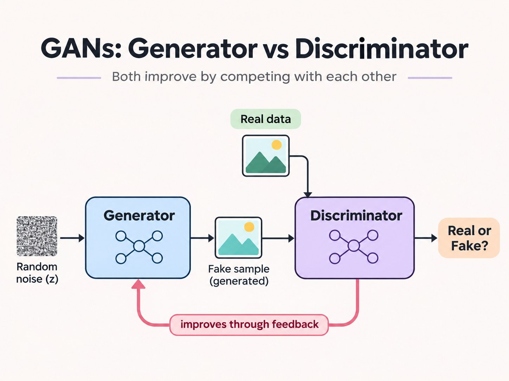

# Two networks, one game

A generative adversarial network is not one model. It is two, trained against each other.

The **generator** starts from random noise and tries to make a sample that looks as if it came from the real data. The **discriminator** looks at a sample and tries to say whether it is real or fake. Each time the discriminator is right, the generator has to do better. Each time the generator fools it, the discriminator has to look more carefully. Both improve by competing.

That idea was introduced in [Generative Adversarial Nets](https://arxiv.org/abs/1406.2661){.external target="_blank"} (Goodfellow, Pouget-Abadie, Mirza, Xu, Warde-Farley, Ozair, Courville and Bengio, 2014). The paper appeared at NIPS 2014; the [proceedings PDF](https://proceedings.neurips.cc/paper_files/paper/2014/file/f033ed80deb0234979a61f95710dbe25-Paper.pdf){.external target="_blank"} is the published version, and the [arXiv PDF](https://arxiv.org/pdf/1406.2661){.external target="_blank"} is 1406.2661.

The [Generative AI overview](generative-index.qmd) already has a short GAN panel. This page is the walk-through: the analogy, the two players, the minimax objective, the training loop, a tiny live example, the usual failure modes, and the line of famous variants.

::: {.fig-on-white}
{#fig-gan-generator-vs-discriminator fig-alt="Diagram of a generative adversarial network: random noise z enters a generator, which produces a fake sample; a discriminator compares that sample with real data and answers real or fake; a feedback arrow runs back to the generator." .lightbox fig-align="center" width="100%"}
:::

Diagram from [@cneuralnetwork](https://x.com/cneuralnetwork/status/2120816118738657458){.external target="_blank"} (12 November 2026).

# Everyday example: a forger and a detective

::: {.callout-tip}
# Everyday example

Think of a forger and a detective. The forger sits in a back room with a stack of blank paper (that is the noise $z$) and tries to draw banknotes. The detective is shown a mix of real notes from the bank and the forger's attempts, and has to say which is which. On Monday the forger's notes are crude, and the detective spots them at a glance. On Tuesday the forger has learned from those mistakes. The detective now has to look more closely — the watermark, the feel of the paper. As the weeks go by, the fakes get better and the detective gets sharper. If the game is going well, there comes a day when the detective is no more sure than a coin toss.

The 2014 paper uses a close cousin of this story: a team of counterfeiters against the police, until the fakes are indistinguishable from genuine currency.
:::

The forger is the generator $G$. The detective is the discriminator $D$. Neither is much use on their own: a generator with no critic can produce anything; a discriminator with no forger has nothing new to practise on. The useful object is the *game*.

# The two players

Let $x$ be a real sample, drawn from the data distribution $p_{\text{data}}$. Let $z$ be a noise vector, drawn from a simple prior $p_z$ — often a standard normal, or a uniform box. The generator is a differentiable function $G(z; \theta_g)$, almost always a neural net, that turns $z$ into a fake sample $\tilde{x} = G(z)$. The discriminator $D(x; \theta_d)$ is a second net that outputs a single number between $0$ and $1$: its estimate of the probability that $x$ came from the real data rather than from $G$.

- $D$ is trained to be right: $D(x)$ should be high for real $x$, and $D(G(z))$ should be low for fakes.
- $G$ is trained to make $D$ wrong: it wants $D(G(z))$ to be high — "the detective thinks this is real".

The paper notes that when $G$ and $D$ have enough capacity, the game has a unique solution: $G$ recovers the data distribution, and $D(x) = \tfrac{1}{2}$ everywhere. In other words, the forger has matched the bank, and the detective can no longer tell.

# The minimax objective

The two aims are packed into one value function. $D$ wants to *maximise* it; $G$ wants to *minimise* it. Equation (1) in the paper is

$$
\min_G \max_D V(D, G)
=
\mathbb{E}_{x \sim p_{\text{data}}(x)}\bigl[\log D(x)\bigr]
+
\mathbb{E}_{z \sim p_z(z)}\bigl[\log\bigl(1 - D(G(z))\bigr)\bigr].
$$

The first term rewards the detective for recognising a real note. The second term rewards the detective for recognising a fake — and, because $G$ sits inside it, punishes the forger when the fake is obvious.

That is a two-player minimax game. In the article we will also need a practical twist, which the paper itself recommends. Early in training, when $G$ is still poor, $D$ can reject fakes with high confidence. Then $\log(1 - D(G(z)))$ flattens out, and $G$ gets almost no gradient. So, rather than training $G$ to minimise $\log(1 - D(G(z)))$, one can train $G$ to *maximise* $\log D(G(z))$ — "make the detective say *real*". The fixed point of the game is the same, but the gradient is stronger at the start. That is already a first look at vanishing gradients, which we will meet again later.

# Creating the algorithm

**The question.** We have a batch of real examples, and we can draw as much noise $z$ as we like. How do we take one step of the game, so that $D$ gets a little sharper and $G$ gets a little more convincing?

**What we have.** Two nets, $G$ and $D$, and the value function above. We will not try to solve the inner maximisation over $D$ to completion — the paper says that would be too expensive, and would overfit. Instead we *alternate*.

**The loop**, following Algorithm 1 of the paper, is this:

1. Draw a minibatch of noise $z^{(1)}, \ldots, z^{(m)}$ and a minibatch of real examples $x^{(1)}, \ldots, x^{(m)}$.
2. Update $D$ by *ascending* the gradient of $\tfrac{1}{m}\sum_i \bigl[\log D(x^{(i)}) + \log\bigl(1 - D(G(z^{(i)}))\bigr)\bigr]$. The detective studies a mix of real and fake notes, and adjusts so as to label them better.
3. Repeat that discriminator step $k$ times. $k$ is a hyperparameter; in the paper's own experiments they used $k = 1$, the cheapest option.
4. Draw a fresh minibatch of noise. Update $G$ by *descending* the gradient of $\tfrac{1}{m}\sum_i \log\bigl(1 - D(G(z^{(i)}))\bigr)$ — or, in the practical version, by *ascending* $\tfrac{1}{m}\sum_i \log D(G(z^{(i)}))$. The forger does not see the real notes in this step. It only sees the detective's current opinion of its own work.
5. Repeat from the top, for as many iterations as you can afford.

Any standard gradient rule can be used for the updates. The paper used momentum. Modern implementations often use Adam, but that is later practice, not part of the 2014 algorithm.

The editor below is live Python in the browser. It uses only NumPy. A linear generator $G(z) = wz + b$ tries to match a one-dimensional Gaussian, $x \sim \mathcal{N}(4, 0.5^2)$, starting from a generator that is just standard noise. A small one-hidden-layer discriminator plays the detective, and we use the practical $\log D(G(z))$ update for $G$. Press Run after you change a setting if you like.

```{pyodide}
#| autorun: true
import numpy as np

rng = np.random.default_rng(0)
target_mean, target_std = 4.0, 0.5
steps, batch, k = 800, 128, 4
lr_d, lr_g = 0.08, 0.02

# G(z) = w z + b, with z ~ N(0, 1). Start far from the target.
w, b = 1.0, 0.0
# D is a tiny MLP: 1 -> 8 (tanh) -> 1 (sigmoid).
d1 = rng.normal(scale=0.3, size=8)
db1 = np.zeros(8)
d2 = rng.normal(scale=0.3, size=8)
db2 = 0.0

def sigmoid(u):
    return 1.0 / (1.0 + np.exp(-np.clip(u, -20, 20)))

def disc(x):
    pre = x[:, None] * d1[None, :] + db1
    h = np.tanh(pre)
    logit = h @ d2 + db2
    return sigmoid(logit), h, pre

def disc_grads(x, g_logit, h, pre):
    gd2 = (g_logit[:, None] * h).mean(axis=0)
    gdb2 = g_logit.mean()
    gpre = (g_logit[:, None] * d2[None, :]) * (1 - np.tanh(pre) ** 2)
    gd1 = (gpre * x[:, None]).mean(axis=0)
    gdb1 = gpre.mean(axis=0)
    gx = (gpre * d1[None, :]).sum(axis=1)
    return gd1, gdb1, gd2, gdb2, gx

z0 = rng.normal(size=2000)
start_mean, start_std = float((w * z0 + b).mean()), float((w * z0 + b).std())

for _ in range(steps):
    for _ in range(k):
        z = rng.normal(size=batch)
        fake = w * z + b
        real = rng.normal(loc=target_mean, scale=target_std, size=batch)
        p_r, h_r, pre_r = disc(real)
        p_f, h_f, pre_f = disc(fake)
        g1a, b1a, g2a, b2a, _ = disc_grads(real, 1 - p_r, h_r, pre_r)
        g1b, b1b, g2b, b2b, _ = disc_grads(fake, -p_f, h_f, pre_f)
        d1 += lr_d * (g1a + g1b)
        db1 += lr_d * (b1a + b1b)
        d2 += lr_d * (g2a + g2b)
        db2 += lr_d * (b2a + b2b)

    z = rng.normal(size=batch)
    fake = w * z + b
    p_f, h_f, pre_f = disc(fake)
    *_, gx = disc_grads(fake, 1 - p_f, h_f, pre_f)
    w += lr_g * np.mean(gx * z)
    b += lr_g * np.mean(gx)

z1 = rng.normal(size=2000)
samples = w * z1 + b
end_mean, end_std = float(samples.mean()), float(samples.std())

print("Started from generator mean", round(start_mean, 2),
      "and std", round(start_std, 2))
print("Toy GAN check: generator mean", round(end_mean, 2),
      f"(target {target_mean:.2f}), std", round(end_std, 2),
      f"(target {target_std:.2f})")
```

On a typical run the mean moves from about $0$ to about $4$. The standard deviation usually shrinks from $1$ toward $0.5$, though a tiny model like this is not perfectly reliable — which is a fair introduction to the next section.

# When the game goes wrong

Training a GAN is a moving target: every time $G$ changes, the problem that $D$ is solving changes with it. Three failure modes come up again and again.

**Vanishing gradients.** The 2014 paper already warns that $\log(1 - D(G(z)))$ can saturate when $D$ is too confident. [Wasserstein GAN](https://arxiv.org/abs/1701.07875){.external target="_blank"} (Arjovsky, Chintala and Bottou, 2017) later analysed this more carefully: when the ordinary minimax game is used with a strong discriminator, the Jensen–Shannon divergence saturates and the generator's gradient can vanish.

**Instability.** The same WGAN paper opens by saying that training GANs "is well known for being delicate and unstable". Because $G$ and $D$ are chasing each other, a learning rate, an architecture choice, or a slightly too-strong detective can send the game into oscillation rather than toward a match of $p_{\text{data}}$.

**Mode collapse.** The generator finds one sample, or a handful, that already fool the discriminator, and then produces only those. [Improved Techniques for Training GANs](https://arxiv.org/abs/1606.03498){.external target="_blank"} (Salimans, Goodfellow, Zaremba, Cheung, Radford and Chen, 2016) describe it plainly: one of the main failure modes is for the generator to "collapse to a parameter setting where it always emits the same point". The forger has found one banknote the detective will accept, and prints it over and over. Diversity disappears, even if that one fake looks good.

None of these is a reason to avoid the idea. They are the reason later work changed the cost function, the architecture, or both.

# A short family tree

The 2014 game was only the start. A few variants are worth knowing by name, in the order they appeared.

```{mermaid}
flowchart TD
  G["2014 Goodfellow et al.: the minimax game"] --> C["2014 Mirza and Osindero: Conditional GAN"]
  G --> D["2015–16 Radford, Metz and Chintala: DCGAN"]
  D --> W["2017 Arjovsky, Chintala and Bottou: WGAN"]
  D --> Y["2017 Zhu et al.: CycleGAN"]
  D --> S["2018–19 Karras, Laine and Aila: StyleGAN"]
  S --> F["2020 Ho, Jain and Abbeel: DDPM"]
  F --> B["2021 Dhariwal and Nichol: diffusion overtakes GANs on image synthesis"]
```

- **Conditional GAN** ([Mirza and Osindero, 2014](https://arxiv.org/abs/1411.1784){.external target="_blank"}). Both players also see a label or some other condition, so you can ask for *a particular* kind of sample, not just "a sample".
- **DCGAN** ([Radford, Metz and Chintala](https://arxiv.org/abs/1511.06434){.external target="_blank"}, arXiv 2015, ICLR 2016). A convolutional recipe for $G$ and $D$ that made image GANs much more reliable, and became the starting point for a lot of later work.
- **WGAN** ([Arjovsky, Chintala and Bottou, 2017](https://arxiv.org/abs/1701.07875){.external target="_blank"}). Replaces the original game with a Wasserstein distance, so the generator still gets a useful gradient when the discriminator is strong, and mode collapse is harder to fall into.
- **CycleGAN** ([Zhu, Park, Isola and Efros](https://arxiv.org/abs/1703.10593){.external target="_blank"}, ICCV 2017). Translates between two image domains — horses and zebras, summer and winter — without paired examples, by asking the mapping to be cycle-consistent.
- **StyleGAN** ([Karras, Laine and Aila](https://arxiv.org/abs/1812.04948){.external target="_blank"}, CVPR 2019). A generator architecture that offered more control over style, and became a standard for high-quality face generation.
- **Then diffusion.** [Denoising Diffusion Probabilistic Models](https://arxiv.org/abs/2006.11239){.external target="_blank"} (Ho, Jain and Abbeel, 2020) trained a model to reverse a gradual noising process. In 2021, [Diffusion Models Beat GANs on Image Synthesis](https://arxiv.org/abs/2105.05233){.external target="_blank"} (Dhariwal and Nichol) showed that this family could outperform the best GANs on image synthesis. From there, diffusion took the lead for still pictures. The adversarial game did not disappear, but it was no longer the default way to get a photorealistic image.

# In one table

| Piece | What it does |
| --- | --- |
| Generator $G(z)$ | Turns noise $z$ into a fake sample |
| Discriminator $D(x)$ | Estimates the probability that $x$ is real rather than fake |
| Minimax objective | $\min_G \max_D \mathbb{E}_{x}[\log D(x)] + \mathbb{E}_{z}[\log(1 - D(G(z)))]$ |
| Practical $G$ step | Maximise $\log D(G(z))$, so the early gradient does not vanish |
| Training loop | $k$ updates of $D$, then one update of $G$; the paper used $k = 1$ |
| Equilibrium, in theory | $G$ matches $p_{\text{data}}$, and $D(x) = 1/2$ everywhere |
| Typical failures | Vanishing gradients, unstable training, mode collapse |
| Famous later variants | Conditional GAN, DCGAN, WGAN, CycleGAN, StyleGAN |
| After 2020 | Diffusion models overtook GANs on image synthesis |

# FAQ

## Is a GAN one neural network?

No. It is two, with opposite jobs, updated in turn. The object you *sample from* after training is the generator. The discriminator is the teacher (and the critic) that made that generator useful.

## Why start from noise $z$?

If $G$ had no random input, it could only produce one sample. The noise is the blank paper in the back room: different $z$ should become different fakes, so that $G$ covers the distribution rather than a single point.

## How do we know the game has ended?

In the theory of the 2014 paper, the game is won when $G$ has recovered $p_{\text{data}}$ and $D$ outputs $\tfrac{1}{2}$ on every sample. In practice you never see that clean ending. You look at samples, and at whether $D$ is still learning, and you stop when the fakes are good enough — or when the training has collapsed.

## Why is mode collapse so common?

Because the generator is rewarded for fooling the discriminator, not for covering every mode of the data. One very good fake can be a local win, and then $G$ has little reason to explore. That is why later work (feature matching, unrolling, the Wasserstein cost) tried to give $G$ a richer training signal.

## Did diffusion make GANs obsolete?

Not entirely. For still-image generation, diffusion models took the lead after 2021. GANs remain part of the toolkit — they are fast to sample from, once trained, and the adversarial idea still appears inside other systems. The right picture is a change of default, not a disappearance.

# See also

- [Generative AI](generative-index.qmd) — the overview that already places GANs next to VAEs, Transformers and LLMs, and links [Lilian Weng's From GAN to WGAN](https://lilianweng.github.io/posts/2017-08-20-gan/){.external target="_blank"}.
- [The evolution of attention](evolution-of-attention.qmd) and [Attention Is All You Need](attention-is-all-you-need.qmd) — another 2010s idea that changed what generative models look like, from a different direction.
- [Transformer by hand](transformer-by-hand.qmd) — a tiny worked block, in the same "compute it once yourself" spirit as the cell above.
- [ANN: Introduction](/ann/ann-introduction.qmd), [Activation functions](/ann/ann-activation-functions.qmd) and [Model and demos](/ann/ann-model-and-demos.qmd) — the networks that $G$ and $D$ are made of.
- [Generative Adversarial Nets](https://arxiv.org/abs/1406.2661){.external target="_blank"} — the 2014 paper, and the [NIPS 2014 PDF](https://proceedings.neurips.cc/paper_files/paper/2014/file/f033ed80deb0234979a61f95710dbe25-Paper.pdf){.external target="_blank"}.
