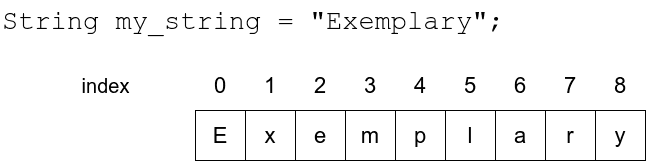
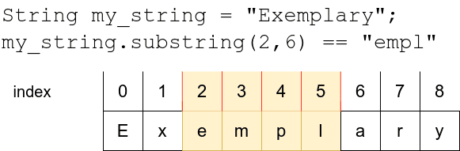
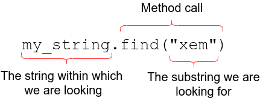
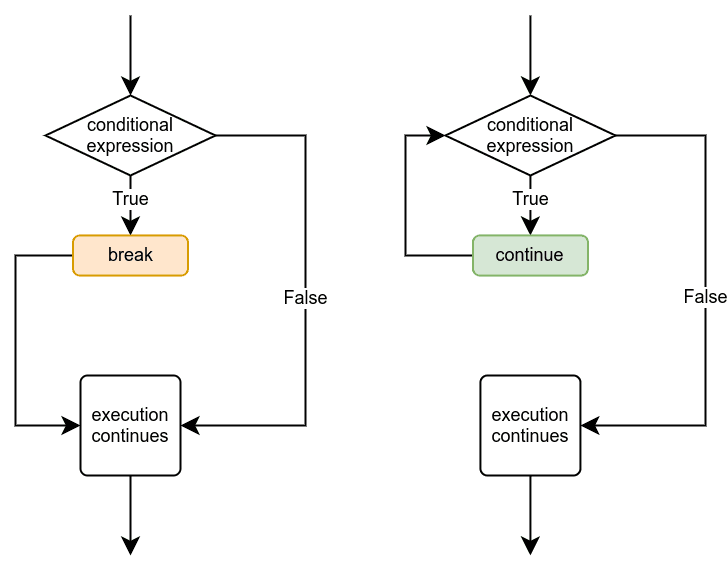

# Introduction to Programming: Part 3

## Loops

- [Part 3](https://programming-24.mooc.fi/part-3/){.external target='_blank'}
- [Part 1: Loops with conditions](https://programming-24.mooc.fi/part-3/1-loops-with-conditions){.external target='_blank'}
- [Part 2: Working with strings](https://programming-24.mooc.fi/part-3/2-working-with-strings){.external target='_blank'}
- [Part 3: More loops](https://programming-24.mooc.fi/part-3/3-more-loops){.external target='_blank'}
- [Part 4: Defining functions](https://programming-24.mooc.fi/part-3/4-defining-functions){.external target='_blank'}


# Some notes

## Writing conditions

Any `Boolean` expression or combination thereof is a valid condition in a loop. For example, the following program prints out every third number, but only as long as the number is less than 100 and not divisible by 5:

``` py
number = int(input("Please type in a number: "))

while number < 100 and number % 5 != 0:
    print(number)
    number += 3
Two examples of the program's execution with different inputs:
```

Sample output
```
Please type in a number: 28
28
31
34
37
```

Sample output
```
Please type in a number: 96
96
99
```

## Debugging

> Python Tutor helps you do programming homework assignments in Python, Java, C, C++, and JavaScript. It contains a step-by-step visual debugger and AI tutor to help you understand and debug code.

- [Online Compiler, AI Tutor, and Visual Debugger for Python, Java, C, C++, and JavaScript](https://pythontutor.com/){.external target='_blank'}
- [Python Tutor: Visualize Code and Get AI Help for Python, JavaScript, C, C++, and Java](https://pythontutor.com/render.html#mode=display){.external target='_blank'}


## Building strings

The += operator allows us to write this a little more compactly, this also applies to f-strings, which may come in handy if values stored in variables are needed as parts of the resulting string. For example this would work:

``` py
course = "Introduction to Programming"
grade = 4

verdict = "You have received "
verdict += f"the grade {grade} "
verdict += f"from the course {course}"

print(verdict)
```

Sample output
```
You have received the grade 4 from the course Introduction to Programming
```

## String

The `*` operator can also be used with a string, when the other operand is an integer.

The string operand is then repeated the number of times specified by the integer. For example this would work:

``` py
word = "banana"
print(word*3)
```

Sample output
```
bananabananabanana
```

> As strings are essentially sequences of characters, any single character in a string can also be retrieved. The operator `[]` **finds the character with the `index` specified within the brackets.**

The `index` refers to a position in the string, counting up from zero. The first character in the string has `index` 0, the second character has `index` 1, and so forth.


{.lightbox width=80% fig-align="center"}


For example, this program

```py
input_string = input("Please type in a string: ")
print(input_string[0])
print(input_string[1])
print(input_string[3])
would print out this:
```

Sample output
```
Please type in a string: monkey
m
o
k
```

### IndexError: string index out of range

If you tried the above examples for yourself, you may already have come across the error message `IndexError: string index out of range`.

> This error appears if you try to access an index which is not present in the string.

``` py
input_string = input("Please type in a string: ")
print("The tenth character: " + input_string[9])
Sample output
Please type in a string: introduction to programming
The tenth character: i
```


Sample output
```
Please type in a string: python

Traceback (most recent call last):
File "", line 1, in 
IndexError: string index out of range
```

## Substrings and slices

> A `substring` of a string is a sequence of characters that forms a part of the string.
>
> For example, the string example contains the `substrings` exam, amp and ple, among others.

In Python programming, the process of selecting `substrings` is usually called **slicing**, and a `substring` **is often referred to as a slice of the string. The two terms can often be used interchangeably.**

If you know the beginning and end indexes of the slice you wish to extract, you can do so with the notation `[a:b]`. **This means the slice begins at the index a and ends at the last character before index b - that is, including the first, but excluding the last.**

You can think of the indexes as separator lines drawn on the left side of the indexed character, as illustrated in the image below:


{.lightbox width=80% fig-align="center"}

Let's have a closer look at some sliced strings:

``` PY
input_string = "presumptious"

print(input_string[0:3])
print(input_string[4:10])

# if the beginning index is left out, it defaults to 0
print(input_string[:3])

# if the end index is left out, it defaults to the length of the string
print(input_string[4:])

```

Sample output
```
pre
umptio
pre
umptious
```

::: {.callout-note}
# Half open intervals
In Python string processing the interval `[a:b]` **is half open, which in this case means that the character at the beginning index a is included in the interval, but the character at the end index b is left out.**

*Why is that?*

There is no profound reason for this feature. Rather it is a convention inherited from other programming languages.

Half open intervals may feel unintuitive, but in practice they do have some advantages. For example, you can easily calculate the length of a slice with b-a. On the other hand, you must always remember that the character at the end index b will not be included in the slice.

:::

## Searching for substrings

The `in` operator can tell us **if a string contains a particular substring.** 

> The Boolean expression `a in b` is true, if `b` contains the substring `a`.

The operator `in` returns a Boolean value, so it will only tell us if a substring exists in a `string`, but it will not be useful in finding out where exactly it is.

Instead, the `Python` string method find can be used for this purpose.

> It takes the substring searched for as an argument, and returns either the first index where it is found, or -1 if the substring is not found within the string.

The image below illustrates how it is used:

{.lightbox width=80% fig-align="center"}

## The continue command

Another way to change the way a loop is executed is the `continue` command. It causes the execution of the loop to jump straight to the beginning of the loop, where the condition of the loop is. Then the execution `continues` normally with checking the condition:

{.lightbox width=80% fig-align="center"}

### More helper variables with loops

Example

``` py
sentence = input('Please type in a sentence: ')

words = sentence.split(' ')
for word in words:
    print(word[0])
```

Sample output
```
Please type in a sentence: Love Python a lot
L
P
a
l
```

## Else without if

In Python, **a `while` loop can have an `else` block without an `if` statement**. This structure is unique to Python and can be useful in certain scenarios. Here's an example:

``` py
count = 0
while count < 5:
    print(f"Count: {count}")
    count += 1
else:
    print("Loop completed successfully")
```

> In this example, the while loop executes as long as the condition `count < 5` is `true`.
>
> The loop body increments the count and prints its value.
>
> Once the condition becomes `false` (*when count reaches 5*), the **else block is executed.**

::: {.callout-note}
The else block in a while loop runs if the loop completes normally, without encountering a break statement.

It's particularly useful for scenarios where you want to perform an action after a loop finishes its normal execution, such as in search algorithms or when you need to confirm that a loop has completed without interruption
:::

## The function definition

Before a function can be used, it must be defined. Any function definition begins with the keyword def, short for define. Then comes the name of the function, followed by parentheses and a colon character. This is called the header of the function. After this, indented just like while and if blocks, comes the body of the function.

For example, the following code defines the function message:

``` py
def message():
    print("This is my very own function!")
```